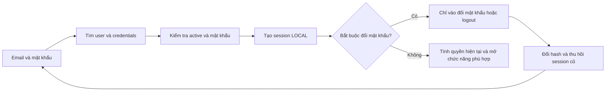
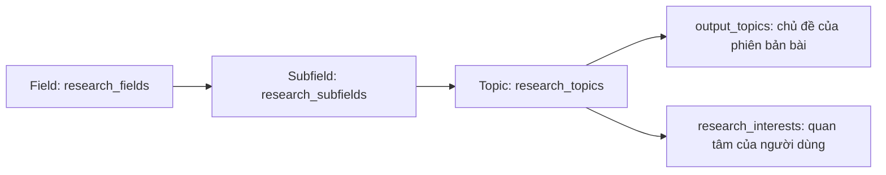
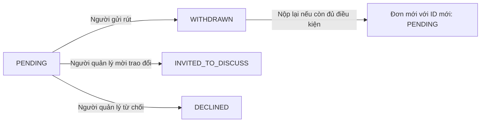

# Hiểu database ResearchOS qua các flow sử dụng

Tài liệu dành cho người cần hiểu **người dùng làm gì, dữ liệu đi vào bảng nào và vì sao cần bảng đó**. Nội dung bám theo [ResearchOS.dbml](ResearchOS.dbml) và [ResearchOS.sql](ResearchOS.sql), phiên bản 4.3 ngày 30/10/2026. MVP đăng nhập bằng email/mật khẩu; OIDC/SSO được giữ cho giai đoạn sau.

Các flow dưới đây mô tả cách ứng dụng cần vận hành theo thiết kế. Database đã có ràng buộc và kiểm tra liên quan, nhưng API đăng nhập LOCAL, cấp/reset mật khẩu, bootstrap admin, SSO thực tế, đồng bộ OpenAlex và gửi email chưa được triển khai trong phần việc này. Chi tiết kỹ thuật và kết quả kiểm chứng nằm trong [README](README.md).

## Trước khi đọc: các khái niệm cần phân biệt

| Khái niệm | Hiểu đơn giản | Ví dụ |
|---|---|---|
| Tài khoản | Một người trong trường | Cô An, sinh viên Bình |
| Researcher | Quyền sử dụng các chức năng nghiên cứu | Đăng bài, tạo topic, apply, follow |
| Admin | Quyền quản lý tài khoản, cấp/thu hồi role theo chính sách hệ thống | Không tự được sửa bài hay đọc file riêng tư của người khác |
| Owner công trình | Người quản lý một bài cụ thể | Cô An quản lý bài P1 |
| Leader group | Người quản lý một nhóm cụ thể | Thầy Cường dẫn dắt nhóm G1 |

Một người có thể đồng thời mang nhiều vai trò này. Quyền ADMIN và RESEARCHER độc lập. Có researcher không có nghĩa là được sửa bài của tất cả mọi người; là tác giả hoặc admin cũng không tự động trở thành owner/Leader.

Trong ví dụ xuyên suốt:

- **Cô An** là giáo viên, có quyền researcher và chưa thuộc group nào lúc bắt đầu.
- **Bình** là sinh viên, ban đầu chỉ có quyền guest.
- **Thầy Cường** là researcher và Leader của group **G1**.
- **Chị Hà** là STAFF, được cấp ADMIN để quản lý tài khoản; chị chưa có quyền researcher nếu chưa được cấp thêm.
- **P1** là công trình do cô An quản lý. **V1, V2** là các phiên bản nội dung của P1.

Các mã P1, V1, G1 là nhãn minh họa cho dễ đọc. ID thật trong database là UUID.

## Bản đồ các flow

| Flow | Người dùng muốn làm gì? | Nhóm bảng chính |
|---|---|---|
| 1 | Đăng nhập email/mật khẩu, đổi/reset; OIDC tương lai | User, local credentials, session, OIDC |
| 2 | Cấp/thu hồi ADMIN và RESEARCHER | User role assignment |
| 3 | Hoàn thiện hồ sơ, xác nhận tác giả | Profile, author, claim, interest |
| 4 | Chọn chủ đề hoặc thêm bằng Other | Field, Subfield, Topic |
| 5 | Đăng bài cá nhân và sửa phiên bản mới | Output, revision, topic, file |
| 6 | Tạo group và đưa bài lên group | Group, member, direction, output link |
| 7 | Tìm kiếm, đọc bài và tải file | Các view/hàm đọc theo quyền |
| 8 | Đăng cơ hội, apply, rút và phản hồi | Opportunity, application |
| 9 | Follow và nhận email tổng hợp | Follow, update, digest |
| 10 | Đăng tin thành tựu và seminar | Post, seminar |
| 11 | Mở rộng sang project và ghi chép nghiên cứu | Các bảng dành cho phase sau |
| 12 | Khóa tài khoản và bàn giao owner/Leader | User, session, resource handover |

## Flow 1 — Đăng nhập bằng email và mật khẩu

**Mục tiêu:** dùng tài khoản được cấp sẵn/mời để xác thực người dùng, rồi tính quyền hiện tại. Không có đăng ký công khai cho phép tự chọn FACULTY hoặc ADMIN.



| Bước | Hệ thống làm gì? | Bảng đọc/ghi |
|---|---|---|
| 1. Cấp tài khoản | Người có thẩm quyền xác minh thông tin, tạo user và mật khẩu tạm đã hash | Ghi `users`, `local_credentials` |
| 2. Cô An nhập email/mật khẩu | Chuẩn hóa email, tìm tài khoản và kiểm tra active | Đọc `users` |
| 3. Kiểm tra mật khẩu | Backend dùng thư viện verify password hash | Đọc `local_credentials.password_hash` |
| 4. Tạo phiên sau khi xác thực thành công | Lưu hash token session, `auth_method=LOCAL`, `identity_id=NULL` | Ghi `user_sessions` |
| 5. Kiểm tra lần đăng nhập đầu | Nếu phải đổi mật khẩu, chỉ cho vào flow đổi mật khẩu/logout | Đọc `local_credentials.must_change_password` |
| 6. Sử dụng ứng dụng | Kiểm tra session, active và quyền hiện tại trên từng request | Đọc `user_sessions`, view `effective_user_access` |

### Tại sao cần `local_credentials` riêng?

`users` lưu thông tin người dùng và email duy nhất dùng để đăng nhập. `local_credentials` chỉ lưu một bộ thông tin mật khẩu cho mỗi user, không sao chép thêm email/username.

| Cột | Cách hiểu |
|---|---|
| `user_id` | Thuộc user nào; một user có tối đa một bộ credentials |
| `password_hash` | Kết quả hash một chiều, không phải mật khẩu gốc hay mật khẩu mã hóa có thể giải mã |
| `password_changed_at` | Lần thay hash mật khẩu gần nhất |
| `must_change_password` | Có phải đổi mật khẩu trước khi dùng các chức năng bình thường không? |
| `created_at`, `updated_at` | Thời điểm tạo/cập nhật credentials |

Mật khẩu tạm phải được backend hash trước khi ghi DB và chuyển tới người dùng qua quy trình cấp/mời được kiểm soát. Database không tự tạo mật khẩu hoặc tự kiểm chứng chất lượng hash. Không để người dùng tự chọn loại tài khoản dựa vào email; chưa có `fptu_guid` đã xác minh thì để NULL, không tạo mã giả.

### Đổi mật khẩu, reset và đăng xuất

- **Lần đầu đăng nhập:** `must_change_password=true`. Middleware chặn chức năng nghiệp vụ/quản trị cho session LOCAL này cho đến khi hoàn thành đổi mật khẩu; session còn hạn không có nghĩa là được bỏ qua bước đổi.
- **Tự đổi mật khẩu:** backend xác minh người thực hiện, kiểm tra mật khẩu mới, ghi hash mới và đặt `must_change_password=false`. SQL tự cập nhật mốc đổi và thu hồi mọi session cũ của user. Người dùng đăng nhập lại bằng mật khẩu mới.
- **Reset có thẩm quyền:** quy trình quản trị xác minh yêu cầu, đặt hash mật khẩu tạm mới và `must_change_password=true`. Session cũ cũng bị thu hồi. Admin không thể đọc lại mật khẩu gốc vì DB không lưu nó.
- **Đăng xuất:** revoke session hiện tại bằng `revoked_at` rồi xóa cookie. “Đăng xuất mọi thiết bị” revoke mọi session của user.
- **Vô hiệu hóa tài khoản:** user inactive không dùng được session/role đang có. Trigger tự revoke session cũ ngay khi khóa; mở lại tài khoản cần đăng nhập lại, không hồi sinh phiên cũ.

Backend dùng transaction READ COMMITTED và khóa theo thứ tự **tài khoản → credentials → session**, giữ khóa đến khi hoàn tất. Login đọc và verify hash sau khi lấy khóa; đổi/reset mật khẩu cũng theo thứ tự này. Nhờ đó không dùng kết quả verify cũ sau một lần reset đồng thời. Trigger tạo session còn kiểm tra và khóa tài khoản cho cả LOCAL/OIDC: nếu tài khoản đang bị khóa, login phải chờ rồi bị từ chối; nếu session tạo trước, thao tác khóa tài khoản chờ rồi thu hồi nó. Các trigger hỗ trợ dữ liệu, chưa phải API login/reset đã hoạt động.

### OIDC/SSO sau này vẫn dùng chung user

Giữ ba bảng: `oidc_login_attempts` cho một lần bắt đầu SSO, `oidc_identities` cho danh tính issuer/subject lâu dài, và `user_sessions` dùng chung cho cả hai phương thức.

```text
Email + mật khẩu → local_credentials → users.id của cô An
SSO đã xác minh → oidc_identities    → cùng users.id của cô An
                                          ↓
                         cùng profile, công trình và quyền
```

OIDC thành công tạo session `auth_method=OIDC`, có `identity_id` thuộc đúng user. LOCAL không cần identity OIDC và không tạo danh tính giả. Khi tích hợp SSO không tạo một user thứ hai chỉ vì phương thức đăng nhập khác; backend liên kết sau khi xác minh, không tự liên kết chỉ do email trùng.

Session giữ hạn tuyệt đối, hạn idle và trạng thái thu hồi; không giữ bản sao ADMIN/RESEARCHER. Khi đổi mật khẩu LOCAL, chính sách schema hiện thu hồi mọi session ứng dụng cũ, gồm cả OIDC. SSO thực tế và quy trình liên kết tài khoản chưa được triển khai.

## Flow 2 — Cấp và thu hồi quyền RESEARCHER / ADMIN

**Mục tiêu:** tách loại người dùng khỏi quyền sử dụng, và tách quyền quản trị khỏi quyền nghiên cứu.

| Tài khoản active | Không có grant bổ sung | Khi có grant hiệu lực |
|---|---|---|
| FACULTY, ví dụ cô An | Researcher, không tự là admin | Có thể thêm ADMIN |
| STUDENT, ví dụ Bình | Guest đã xác thực | Thêm RESEARCHER thì dùng tính năng researcher như giáo viên |
| STAFF, ví dụ chị Hà | Guest đã xác thực | ADMIN để quản trị; RESEARCHER phải cấp riêng nếu cần |

Một tài khoản có thể giữ cả hai role. Tài khoản inactive có cả `is_researcher=false` và `is_admin=false`, dù grant và session chưa hết hiệu lực.

Ví dụ chị Hà chỉ được cấp ADMIN: chị quản lý tài khoản theo policy nhưng chưa đăng bài, tạo Topic hoặc follow như researcher. Chị cũng không tự là Leader của G1, không sửa P1 của cô An và không tải file PRIVATE của cô An.

### Dữ liệu khi cấp quyền

`user_role_assignments` lưu `user_id`, role ghi rõ, nguồn cấp, người/thời điểm cấp, người/thời điểm thu hồi và lý do.

| Cách cấp | `grant_source` | `granted_by` | Quy tắc |
|---|---|---|---|
| Admin cấp qua chức năng quản trị theo policy | MANUAL | User thực hiện đã được xác thực | Bắt buộc có; không được bằng user nhận |
| Command/seed server tin cậy | SYSTEM | NULL | Ví dụ bootstrap admin đầu tiên; không mở cho client lựa chọn |

Không có default RESEARCHER: thao tác cấp phải ghi rõ `role`. Không tạo SYSTEM grant cho mọi giáo viên vì quyền researcher mặc định đã tính từ FACULTY.

Admin đầu tiên cần command/seed được kiểm soát trên server: tạo tài khoản/credentials nếu dùng LOCAL rồi thêm SYSTEM ADMIN. Không có endpoint công khai “tự trở thành admin”. Command/seed và API quản trị này chưa được triển khai.

### Dữ liệu khi thu hồi

Ví dụ chị Hà cấp RESEARCHER cho Bình: thêm một hàng MANUAL, `granted_by=Hà`. Khi thu hồi, điền `revoked_at`, `revoked_by`; không xóa hàng cũ. Bình trở lại guest nếu không còn grant researcher hiệu lực.

Nếu cô An từng có grant RESEARCHER bổ sung rồi bị revoke, cô vẫn có quyền researcher mặc định từ FACULTY. Nếu chị Hà có cả hai role, revoke ADMIN không làm mất RESEARCHER và ngược lại. Grant có thời điểm `granted_at` trong tương lai chưa có hiệu lực.

Không đổi Bình hoặc chị Hà thành FACULTY để cấp quyền. DB tính hai quyền qua `effective_user_access`; backend lấy actor từ session, kiểm tra ADMIN và policy trước khi cho cấp/thu hồi. CHECK nguồn cấp/người cấp chỉ kiểm tra dữ liệu, không thay việc xác thực người thực hiện.

ADMIN chỉ bổ sung chức năng quản trị được phép, không tạo quyền đọc riêng tư hay quyền quản lý mọi tài nguyên. Các helper owner/group/file tiếp tục dùng quyền theo từng tài nguyên.

### Chị Hà có ADMIN thì làm được những gì?

| Công việc | Policy MVP |
|---|---|
| Tạo tài khoản, sửa email/loại tài khoản/đơn vị | Được, dựa trên thông tin đã xác minh và ghi lý do. Không đổi người thành FACULTY để lách việc cấp quyền |
| Cấp/thu hồi RESEARCHER hoặc ADMIN cho người khác | Được, giữ lịch sử; không tự cấp role; bảo vệ admin active cuối cùng |
| Khóa/mở tài khoản, thu hồi session, khởi động reset mật khẩu | Được theo quy trình xác minh; không đọc được mật khẩu cũ |
| Bàn giao owner công trình hoặc Leader group | Được thực hiện theo Flow 12 với căn cứ hợp lệ, không tùy ý chuyển về mình |
| Đọc mọi application, bài PRIVATE hoặc file riêng | Không; vẫn phải có quyền theo tài nguyên |
| Sửa/phát hành bài của mọi người, duyệt bài cho mọi group | Không; quyền owner/Leader vẫn độc lập |
| Bắt Topic mới phải chờ ADMIN duyệt | Không có bước này; Other hoạt động ngay |

Không được thu hồi/khóa admin active cuối cùng. Ví dụ nếu chỉ còn chị Hà là admin thì chị cần bổ nhiệm một admin khác đang active trước. Backend phải gọi helper `assert_admin_removal_allowed` trước khi thay đổi, giữ cùng transaction và khóa điều phối; không chỉ đếm admin trên màn hình rồi gửi request. Đây là quy tắc đã có helper SQL và kiểm tra đồng thời, chưa có API quản trị thực tế.

Guest được tìm kiếm và đọc nội dung được phép. Guest không đăng bài, tạo topic, đăng opportunity, apply, follow hoặc bật digest. Việc có profile hay được ghi trong danh sách thành viên không tự cấp researcher.

## Flow 3 — Hoàn thiện hồ sơ và xác nhận “tôi là tác giả”

**Mục tiêu:** hồ sơ phản ánh đúng người dùng, công trình họ tham gia và chủ đề họ quan tâm.

| Thao tác | Bảng liên quan | Dữ liệu quan trọng |
|---|---|---|
| Xác nhận thông tin cá nhân | `users` | Tên, khoa/đơn vị, học hàm/học vị nếu có |
| Cập nhật hồ sơ nghiên cứu | `researcher_profiles` | ORCID, bio, ảnh đại diện, trạng thái sẵn sàng hợp tác |
| Hệ thống ghi nhận tác giả của một bài | `output_authors` | Tên tác giả, thứ tự, tác giả liên hệ, `user_id` nếu đã biết |
| Gợi ý bài có thể thuộc người dùng | `publication_claims` | Bài, user, tác giả ứng viên, trạng thái SUGGESTED |
| Người dùng xác nhận hoặc từ chối | `publication_claims` | CONFIRMED hoặc REJECTED và `reviewed_at` |
| Chọn chủ đề quan tâm | `research_interests` | User, Topic, nguồn hình thành interest, trạng thái |

Trong `users`, `academic_title` là **học hàm** như GS/PGS; `academic_degree` là **học vị** như ThS/TS. Hai cột này mô tả hồ sơ, không cấp ADMIN hoặc RESEARCHER.

Ví dụ bài P1 có tên tác giả “An Nguyen”. Hệ thống gợi ý cho cô An rằng đây có thể là bài của cô. Khi xác nhận, backend cập nhật claim và mapping tác giả phù hợp trong một transaction, sau khi kiểm tra không có xung đột.

Xác nhận này chỉ nói **cô An là tác giả**. Nó không tự đổi `research_outputs.owner_id`, không tự phát hành bài và không tự gắn bài vào group.

Hồ sơ researcher có các mốc:

- `profile_confirmed_at`: đã xác nhận thông tin hồ sơ.
- `papers_reviewed_at`: đã xem/xác nhận danh sách bài gợi ý; có thể xác nhận “không có bài phù hợp”.
- `onboarding_completed_at`: backend đánh dấu khi hoàn tất điều kiện onboarding, gồm ít nhất một interest ACTIVE.

Người chưa có publication vẫn hoàn thành onboarding được. Guest không bị ép thực hiện bước ghi interest dành cho researcher.

## Flow 4 — Chọn taxonomy hoặc thêm Topic qua Other

**Mục tiêu:** mọi công trình và interest có thể dùng chung một danh mục chủ đề rõ ràng.



Cây chính có đúng **Field → Subfield → Topic**. `research_subfields.field_id` chỉ ra Field cha; `research_topics.subfield_id` chỉ ra Subfield cha. Không có Domain trong cây này.

### Khi chọn chủ đề đã có

Ứng dụng đọc danh mục từ ba bảng trên. Cô An chọn một Topic để gắn vào bài hoặc hồ sơ. Không tạo thêm một Topic chỉ vì có người dùng mới chọn nó.

### Khi dùng Other

1. Cô An chọn Subfield phù hợp.
2. Cô nhập tên Topic còn thiếu, ví dụ “Ứng dụng AI trong hỗ trợ học tập”. Đây là ví dụ tên LOCAL, không phải khẳng định có Topic OpenAlex cùng tên.
3. Backend xác thực cô có quyền researcher. Database chuẩn hóa khoảng trắng và kiểm tra tên LOCAL trùng trong cùng Subfield.
4. Tạo hàng `research_topics` với `source=LOCAL`, `created_by=An`, `external_id=NULL`, `is_active=true`.
5. Topic dùng được ngay. Có thể gắn vào bản nháp hoặc interest; không chờ đăng bài, Leader hay Area Owner duyệt.

Nếu hai người cùng tạo một tên LOCAL trong cùng Subfield, ràng buộc unique chỉ cho một hàng thành công. API nên hướng người thứ hai dùng Topic đã có. Khác biệt hoa/thường hoặc khoảng trắng không tạo ra một Topic LOCAL mới.

### Khi đồng bộ OpenAlex

Thiết kế dành các cột `source`, `external_id`, `last_synced_at`, `source_updated_at` ở cả ba cấp. Worker tương lai nhập Field trước, rồi Subfield, rồi Topic; nối cha theo **ID nguồn**, không đoán theo tên.

Ví dụ một Topic nguồn đổi tên, nhưng external ID giữ nguyên: cập nhật tên trên hàng cũ, không tạo Topic khác. LOCAL và imported trùng nhãn vẫn là hai đối tượng riêng; hệ thống không tự merge hoặc ghi đè LOCAL. Tên chỉ là nhãn, cặp `source + external_id` mới nhận diện đối tượng imported.

### Topic của bài khác interest của người

| Câu hỏi | Bảng trả lời |
|---|---|
| Phiên bản bài P1 nói về chủ đề nào? | `output_topics` |
| Cô An quan tâm chủ đề nào? | `research_interests` |

Cô An tự chọn Topic từ OpenAlex thì interest vẫn là **DECLARED + ACTIVE**. OPENALEX là nguồn danh mục, không phải bằng chứng hệ thống đã suy luận sở thích của cô.

Chỉ khi hệ thống suy luận interest mới dùng **INFERRED + SUGGESTED**. Cô đồng ý thì giữ INFERRED và chuyển ACTIVE; từ chối thì chuyển REJECTED để giữ phản hồi. Phần suy luận chưa được triển khai.

## Flow 5 — Đăng bài cá nhân, sửa bài và lưu trữ

**Mục tiêu:** cô An có thể đăng bài khi chưa thuộc bất kỳ group nào.

MVP dùng flow cô An chủ động thêm công trình mình có quyền quản lý; backend đặt cô làm owner từ tài khoản đã xác thực. Tự động nhập hàng loạt bài từ bên ngoài mà chưa biết người quản lý để phase sau. Cột owner cho phép NULL nhằm hỗ trợ trường hợp tương lai đó, không mở đường đăng bài vô chủ.

### Ba lớp dữ liệu của một công trình

| Lớp | Bảng | Ví dụ |
|---|---|---|
| Danh tính công trình | `research_outputs` | P1, owner là An, DOI, phạm vi xem |
| Nội dung từng phiên bản | `output_revisions` | P1 có V1 và V2, mỗi bản có title/abstract/năm xuất bản riêng |
| Nội dung đi kèm phiên bản | `output_topics`, `output_revision_files` | V1 dùng Topic T1 và file F1; V2 có thể dùng T2, F2 |

`output_files` lưu thông tin file thực tế trong storage: tên, đường dẫn lưu, kích thước, mã kiểm tra nội dung và phạm vi xem. `output_revision_files` chỉ ghi **phiên bản nào sử dụng file nào**, nên một file không đổi có thể dùng lại ở nhiều phiên bản.

`output_external_ids` lưu ID bài tại nguồn ngoài. `output_authors` lưu danh sách/mapping tác giả hiện tại; `output_revisions.authors_snapshot` giữ danh sách tác giả tại thời điểm phát hành để bản cũ không bị thay theo các chỉnh sửa sau này.

### Lần đăng đầu tiên

| Bước | Ghi dữ liệu | Người khác thấy gì? |
|---|---|---|
| 1. Tạo bài | Tạo P1 trong `research_outputs`, `owner_id=An`, `sharing_status=DRAFT` | Chưa thấy trong Discovery |
| 2. Soạn nội dung | Tạo V1 trong `output_revisions`, `released_at=NULL` | Vẫn chưa thấy bản nháp |
| 3. Chọn topic/upload file | Ghi `output_topics`, `output_files`, `output_revision_files` | Vẫn chưa thấy bản nháp |
| 4. Bấm đăng | Phát hành V1, đặt `current_release_id=V1`, chuyển P1 sang SHARED, ghi `first_shared_at` | Thấy V1 nếu được phép theo visibility |

Backend phải xác thực người bấm đăng là **owner và còn quyền researcher**. Các thay đổi ở bước 4 phải cùng thành công hoặc cùng bị hủy trong một transaction.

SQL đồng thời ghi sự kiện chia sẻ vào `research_updates` để làm nguồn cho digest. Không có `group_output_links` cũng không cản bài xuất hiện trong Discovery.

### Khi người khác đã thêm cùng bài báo

Nếu Bình thêm P1 bằng DOI đã có, hệ thống dùng lại công trình P1, không tạo thêm bản sao. SQL chuẩn hóa DOI và chặn trùng cả khi người này nhập mã DOI, người kia dán URL doi.org, kể cả có space/tab/xuống dòng ở đầu hoặc cuối do copy/paste. Ký tự bên trong DOI được giữ nguyên ngoài việc chuyển chữ thường; backend vẫn phải kiểm tra định dạng. Nếu Bình được xem bài, ứng dụng có thể dẫn tới bài và flow claim tác giả; claim không cho Bình quyền sửa bài của cô An. Nếu P1 là PRIVATE mà Bình không được xem, không trả thông tin bài/owner để làm lộ dữ liệu; hướng Bình tới quy trình hỗ trợ phù hợp.

Với bài chưa có DOI, MVP chỉ cảnh báo nghi trùng, không tự gộp hai bài vì tên gần giống.

### Sửa bài đã đăng

Không sửa trực tiếp V1 đã phát hành. Tạo V2 dạng nháp, sao chép nội dung cần dùng rồi chỉnh sửa.

| Thời điểm | Bản cô An đang sửa | `current_release_id` | Người đọc thấy |
|---|---|---|---|
| Sau lần đăng đầu | Không có bản nháp | V1 | V1 |
| Đang sửa lần hai | V2, chưa phát hành | V1 | V1 |
| Phát hành lần hai | V2 đã phát hành | V2 | V2 |

Title, tác giả, topic và file của bản nháp V2 không được dùng thay cho V1 trên trang công trình hoặc trong bộ lọc Discovery. Database giữ tối đa một revision nháp đang sửa trên mỗi công trình.

### Chia sẻ nội bộ khác xuất bản học thuật

| Trường | Câu hỏi mà trường trả lời |
|---|---|
| `research_outputs.sharing_status` | Công trình đã được chia sẻ trong ResearchOS chưa? |
| `output_revisions.publication_status` | Phiên bản này đã xuất bản trên tạp chí/hội nghị chưa? |

Một preprint có thể là `UNPUBLISHED` về học thuật nhưng `SHARED` trong trường. Không cần đợi tạp chí chấp nhận mới chia sẻ nội bộ.

### Lưu trữ bài

Owner chuyển P1 sang ARCHIVED và ghi `archived_at`. Bài ẩn khỏi Discovery và trang group, nhưng vẫn giữ công trình, phiên bản và liên kết. Nếu khôi phục SHARED, các liên kết group còn được chấp nhận có thể hiển thị trở lại theo quyền xem hiện tại.

## Flow 6 — Tạo group và đưa bài lên trang group

**Mục tiêu:** group có trang nghiên cứu riêng; Leader quyết định nội dung xuất hiện tại group mình.

### Tạo group và quản lý thành viên

| Bảng | Dùng để làm gì? |
|---|---|
| `research_groups` | Thông tin group, `lead_id` xác định Leader |
| `group_members` | Các thành viên và vai trò như CORE_MEMBER, COLLABORATOR, STUDENT_MEMBER |
| `group_directions` | Hướng nghiên cứu có tiêu đề/mô tả riêng, có thể tham chiếu Topic |

Ví dụ G1 có hướng “Xây dựng công cụ hỗ trợ giảng dạy tại FPTU”. Đây là kế hoạch/hướng hoạt động của group, có thể gắn một Topic AI trong taxonomy; không phải cứ tạo direction là tạo Topic mới.

Group một người chỉ cần hàng `research_groups` với Leader hợp lệ. Truy vấn thành viên phải tính cả `lead_id`; không yêu cầu Leader có thêm hàng role LEAD trong `group_members`.

Mọi researcher active được tạo group và trở thành Leader, gồm Bình sau khi đã được cấp RESEARCHER và nhân viên có grant tương ứng. Chỉ có ADMIN mà chưa có RESEARCHER thì chưa được tạo group. Backend xác định người tạo từ session và đặt `lead_id` của họ; SQL kiểm tra leader đủ điều kiện.

### Thành viên đề nghị đưa bài vào group

Giả sử sau khi đăng P1, cô An tham gia G1 và muốn đưa bài lên trang nhóm:

1. Cô chọn V1 đã phát hành và gửi đề nghị.
2. Tạo `group_output_links` cho cặp P1–G1: `requested_revision_id=V1`, `requested_by=An`, `status=PENDING`.
3. Thầy Cường xem đề nghị. Nếu đồng ý, ghi `accepted_revision_id=V1`, `accepted_by`, `accepted_at`, thông tin quyết định và chuyển ACCEPTED.
4. Trang G1 hiển thị V1 cho người được phép xem.

Thành viên researcher có thể đề nghị một bài mình được xem, kể cả không phải owner. Thao tác này không cho họ quyền sửa bài. Leader chấp nhận bài vào group cũng không làm Leader thành owner.

### Leader đưa bài mình quản lý vào group

Nếu cô An tạo group G2 và là Leader duy nhất, cô có thể đưa P1 vào G2 **trực tiếp ở trạng thái ACCEPTED**. Không phải tạo đơn PENDING rồi tự duyệt.

### Bài nằm ở hai group

```text
research_outputs: một công trình P1
    current_release_id = V2

group_output_links:
    P1 + G1 → accepted_revision_id = V1
    P1 + G2 → accepted_revision_id = V2
```

P1 không bị nhân đôi. Mỗi group chọn phiên bản đã chấp nhận riêng. Cô An phát hành V2 cá nhân không làm G1 tự chuyển từ V1 sang V2.

### Đề nghị cập nhật hoặc gỡ khỏi group

| Tình huống tại G1 | Trạng thái yêu cầu | Bản G1 đang hiển thị |
|---|---|---|
| V1 đã được chấp nhận | ACCEPTED | V1 |
| Đang đề nghị đổi sang V2 | PENDING | V1 vẫn giữ nguyên |
| Leader từ chối đổi sang V2 | REJECTED | V1 vẫn giữ nguyên |
| Leader chấp nhận V2 | ACCEPTED | V2 |
| Leader gỡ P1 khỏi G1 | REMOVED, xóa giá trị `accepted_revision_id` | Không hiển thị P1 ở G1 |

Vì vậy `status=REJECTED` có thể nghĩa là **từ chối lần cập nhật mới**, không nhất thiết nghĩa là group chưa từng chấp nhận bài. Phải đọc cả `requested_revision_id` và `accepted_revision_id`.

Gỡ P1 khỏi G1 không xóa bài cá nhân, không xóa phiên bản và không tác động liên kết P1–G2. Bảng này lưu trạng thái hiện tại của mỗi cặp bài–group, chưa phải lịch sử đầy đủ của mọi lần từ chối/duyệt.

## Flow 7 — Discovery, đọc bài và tải file

**Mục tiêu:** người đọc thấy đúng phiên bản và đúng nội dung họ được phép xem.

Discovery là cách tổng hợp/truy vấn các bảng, không cần một bảng chứa bản sao mọi kết quả tìm kiếm. Hồ sơ dùng `users` và `researcher_profiles`; nhóm dùng `research_groups`; cơ hội dùng `research_opportunities`; chủ đề dùng ba bảng taxonomy.

Riêng công trình, dùng nội dung **đã phát hành**:

| Nơi hiển thị | Nguồn dữ liệu phù hợp |
|---|---|
| Danh sách bài trong cộng đồng | `visible_output_releases(actor)` |
| Bài trên trang một group | `visible_group_output_releases(actor, group)` |
| Lọc Topic của bài | `output_topics` của revision đang hiển thị |
| Kiểm tra tải file | `can_view_output_file(actor, file)` |

Các tên trên là hàm SQL hỗ trợ backend, không phải bảng mới. `actor` là người dùng mà backend đã xác thực từ session.

### Ba phạm vi xem

| `visibility` | Ai được xem? |
|---|---|
| PRIVATE | Owner đang có tài khoản hoạt động |
| RESEARCH_GROUP | Owner; người thuộc `access_group_id` khi bài đang SHARED và các điều kiện hiệu lực được đáp ứng |
| FPTU_COMMUNITY | Owner; người dùng nội bộ active, gồm guest đã xác thực, khi bài đang SHARED |

Không có chế độ công khai ra Internet trong thiết kế này. Nháp/lưu trữ không tự xuất hiện cho cộng đồng chỉ vì đặt visibility rộng.

**Ví dụ:** P1 hiển thị metadata cho cộng đồng nhưng file F1 là PRIVATE. Bình đọc được tiêu đề/tóm tắt đã phát hành, nhưng không tải được F1. Thầy Cường chấp nhận P1 vào G1 cũng không làm F1 mở quyền.

Quyền tải file cần đồng thời thỏa quyền xem công trình và quyền xem file. Với người không phải owner, file còn phải gắn vào một phiên bản đang được hiển thị cá nhân hoặc group. Nếu owner chuyển P1 thành PRIVATE, các group không tiếp tục hiển thị bài đó cho người không có quyền.

## Flow 8 — Opportunity, application, rút và gửi lại

**Mục tiêu:** researcher tìm người hợp tác mà không bắt buộc có group hoặc project.

### Đăng opportunity

Cô An tạo một cơ hội cá nhân. `research_opportunities.group_id` và `project_id` có thể để NULL. Cô là creator và quản lý cơ hội đó.

| Trường | Ý nghĩa | Ví dụ |
|---|---|---|
| `opportunity_kind` | Mục đích của cơ hội | PROJECT_FORMATION |
| `target_audience` | Nhóm đối tượng mong muốn | ANY_RESEARCHER |
| `expected_role` | Vai trò mong muốn, tự nhập | Người phụ trách thiết kế thí nghiệm |
| `required_expertise_tags` | Chuyên môn cần thiết | Phân tích dữ liệu, đánh giá mô hình |
| `application_deadline` | Hạn cuối nhận đơn | Một mốc thời gian cụ thể |
| `response_sla_days` | Số ngày lịch dự kiến phản hồi | 5 ngày |

Cơ hội bắt đầu ở DRAFT. Khi bấm Publish, backend kiểm tra quyền quản lý; DB kiểm tra các điều kiện dữ liệu và chuyển sang OPEN. Cơ hội đại diện group cần quyền quản lý group; gắn project cần quyền phù hợp với project. `creator_id` không giúp người tạo vượt quyền của group/project.

`target_audience=STUDENT` chỉ là mô tả/matching. Bình vẫn cần được cấp researcher mới apply được. Nội dung `expected_role` cũng không cấp quyền hệ thống.

### Gửi application

1. Bình đã được cấp researcher và chọn Apply.
2. Hệ thống kiểm tra cơ hội OPEN, chưa tới hạn, chưa archive.
3. Tạo hàng `opportunity_applications`, trạng thái PENDING, ghi `applicant_note`.
4. DB ghi `applied_at` và tính `response_due_at` theo SLA tại thời điểm nhận đơn.
5. Người gửi và người có quyền xử lý được xem application; người khác không được đọc nội dung đơn.

SLA là **ngày lịch**, gồm cuối tuần/ngày lễ. Ví dụ nhận đơn lúc 10:00 ngày 1, SLA 5 ngày thì hạn phản hồi là 10:00 ngày 6 theo múi giờ nghiệp vụ. Chủ cơ hội đổi SLA thành 7 ngày sau đó không làm đơn cũ đổi hạn.

### Phản hồi hoặc rút đơn



Chỉ chính người gửi rút đơn PENDING của mình. Đơn đã được mời trao đổi hoặc từ chối không được rút để gửi lại theo flow hiện tại.

Ví dụ lịch sử của Bình:

| Application | Trạng thái | Nội dung | Hạn phản hồi |
|---|---|---|---|
| A1 | WITHDRAWN | Nội dung lần đầu | Giữ hạn đã tính lần đầu |
| A2 | PENDING | Nội dung nộp lại | Tính mới từ lúc nộp A2 |

Không đổi A1 trở lại PENDING. Database cho phép nhiều hàng WITHDRAWN trong lịch sử nhưng chỉ một hàng **chưa rút** cho cùng người/cơ hội. Đơn đã được phản hồi vẫn là chưa rút và chặn nộp thêm.

Hai request apply đồng thời không tạo được hai đơn hợp lệ. Phản hồi và rút cùng lúc chỉ một chuyển trạng thái thắng; bên còn lại phải nhận trạng thái hiện tại thay vì ghi đè.

### Khi cơ hội đóng hoặc hết hạn

Không nhận application mới. Các đơn đã nhận vẫn giữ nguyên; người có quyền vẫn có thể phản hồi đơn PENDING. Mời trao đổi không tự thêm Bình vào group hoặc project. Việc thêm thành viên là thao tác riêng sau khi các bên đồng ý.

Thông báo phản hồi application thuộc email/thông báo giao dịch, độc lập với việc người dùng có bật digest hay không. Phần gửi thông báo này chưa được triển khai.

## Flow 9 — Follow và nhận digest hàng tuần

**Mục tiêu:** researcher nhận thông tin mới phù hợp mà không bị lặp cùng một bài nhiều lần trong một email.

| Bảng | Câu hỏi mà bảng trả lời |
|---|---|
| `user_follows` | Người này đang theo dõi ai/cái gì? |
| `digest_preferences` | Người này có chủ động bật nhận email không? |
| `research_updates` | Có hành động chia sẻ nào mới xảy ra? |
| `digest_deliveries` | Kỳ email này của người này đang chờ, đang gửi hay đã gửi? |
| `digest_items` | Email gồm nội dung nào, khớp vì lý do gì? |

Researcher có thể follow researcher, group, Topic, project hoặc công trình; chức năng của module chưa triển khai thì chưa mở nút follow tương ứng. Guest không follow hoặc nhận digest.

### Ví dụ từ follow tới email

1. Bình đã là researcher, follow cô An, group G1 và Topic T1. Ghi ba hàng trong `user_follows`.
2. Bình bật email hàng tuần: `digest_preferences.enabled=true`. Follow không tự bật nhận email.
3. Cô An phát hành P1, rồi G1 chấp nhận P1. SQL ghi các hành động có ý nghĩa vào `research_updates`.
4. Đến kỳ gửi, worker tìm nội dung mới khớp các follow của Bình và kiểm tra quyền xem.
5. Nếu có nội dung hợp lệ, tạo một `digest_deliveries` cho Bình và kỳ đó, cùng các `digest_items`.
6. P1 chỉ thành **một item**, dù khớp cả tác giả, group và Topic. `matched_reasons` có thể giữ cả ba lý do.
7. Trước khi gửi, kiểm tra lại Bình còn researcher, còn bật nhận và còn quyền xem nội dung. Nếu không còn item hợp lệ thì bỏ gửi.

Một thay đổi `updated_at` thông thường hoặc một lần sync metadata không tự thành thông báo. Các sự kiện có ý nghĩa gồm chia sẻ bài lần đầu, phát hành revision mới, chấp nhận bài vào group, mở opportunity, đăng seminar và cập nhật project có ý nghĩa ở phase sau.

`digest_deliveries` lưu số lần thử, hạn giữ job, lỗi và kết quả provider để phục hồi khi worker gián đoạn. Schema giới hạn tối đa 5 lần thử. Worker vẫn phải quản lý retry và đối soát với nhà cung cấp; chỉ có bảng này chưa bảo đảm email không thể bị gửi trùng trong mọi lỗi mạng.

`digest_items.content_snapshot` lưu nội dung đã chọn cho email để truy vết. Snapshot phải được dựng từ nội dung được phép và kiểm tra lại trước gửi, không lấy bản nháp hoặc file riêng tư.

## Flow 10 — Đăng tin thành tựu và seminar

Hai loại nội dung này phục vụ hoạt động cộng đồng nhưng có mục đích khác công trình nghiên cứu.

| Bảng | Dùng khi nào? | Liên hệ với công trình |
|---|---|---|
| `achievement_posts` | Đăng tin, giải thưởng, thông tin cập nhật | Có thể tham chiếu `output_id`, group hoặc project; không thay thao tác phát hành công trình |
| `research_seminars` | Đăng seminar, workshop, paper sharing hoặc họp nghiên cứu | Lưu người tổ chức, lịch, địa điểm/link và group nếu có |

Ví dụ cô An nhận giải thưởng cho P1: tạo một achievement post liên kết P1. Việc viết tin không tạo một công trình P1 thứ hai và không tự đổi quyền xem P1.

Seminar có `organizer_id` là user và `group_id` tùy chọn. `published_at` thể hiện mốc đăng; `scheduled_at` là thời gian diễn ra. Hai mốc này khác nhau. Khi đăng seminar, SQL có thể ghi sự kiện SEMINAR_PUBLISHED cho digest; achievement post hiện không có loại sự kiện digest tự động riêng trong schema.

## Flow 11 — Các bảng dành cho giai đoạn sau

Các bảng này được giữ trong thiết kế nhưng không bắt buộc phải đi qua để đăng một bài cá nhân.

| Bảng | Cách hiểu và vị trí trong flow |
|---|---|
| `research_projects` | Tạo một đề tài/project, có Lead, trạng thái, kinh phí, thời gian; group/direction có thể tùy chọn |
| `project_members` | Thêm người tham gia project với role tương ứng; độc lập với thành viên group |
| `project_milestones` | Chia project thành các mốc và theo dõi hạn/trạng thái |
| `research_records` | Ghi vấn đề, câu hỏi, phương pháp, bằng chứng và phát hiện trong quá trình nghiên cứu; có thể gắn project/milestone/Topic |
| `record_lineage` | Ghi record nào kế thừa phương pháp/dữ liệu hoặc kết quả từ record trước |
| `mentoring_records` | Ghi hoạt động hướng dẫn sinh viên và đề tài được hướng dẫn |
| `interest_circles` | Tạo nhóm quan tâm ban đầu quanh một Topic; có thể ghi nhận group được hình thành về sau |
| `interest_circle_members` | Lưu thành viên của nhóm quan tâm đó |
| `knowledge_graph_edges` | Lưu quan hệ giữa record, output, project, ví dụ CITES hoặc USES_METHOD |

Ví dụ sau khi trao đổi qua opportunity, cô An và Bình đồng ý cùng làm một project. Người có quyền tạo project và thêm Bình vào `project_members`. Một application INVITED_TO_DISCUSS không tự làm các bước này.

Trong quá trình làm project, nhóm ghi nhận thí nghiệm ở `research_records`. Khi viết một bài để chia sẻ, dùng flow `research_outputs`/`output_revisions`. Research record là ghi chép nghiên cứu; output là công trình để chia sẻ. Schema hiện không có bảng liên kết trực tiếp project–output; không giả định tạo bài sẽ tự gắn vào project.

AI tương lai phải tìm trên nội dung mà người hỏi được xem và dẫn về đối tượng thật. Chưa có bảng chat/vector, và knowledge graph không phải điều kiện bắt buộc để có AI search.

## Flow 12 — Khóa tài khoản và bàn giao người phụ trách

**Mục tiêu:** người nghỉ việc hoặc không còn phụ trách ngừng thao tác, còn công trình và group tiếp tục giữ dữ liệu.

### Khi cô An bị khóa tài khoản

1. Chị Hà xác minh yêu cầu và kiểm tra không làm mất admin active cuối cùng nếu tài khoản bị khóa có ADMIN.
2. Backend cập nhật `users.is_active=false`. SQL thu hồi các session chưa revoke với lý do ACCOUNT_DEACTIVATED.
3. Cô An không đăng nhập hoặc dùng quyền researcher/owner/Leader được nữa.
4. P1 và các phiên bản vẫn tồn tại; nếu đang SHARED, người có quyền vẫn xem được theo visibility. Group, các liên kết bài và claim cũng không tự bị xóa/archive.
5. Không tự giao P1 cho một đồng tác giả hoặc tự giao group cho người tham gia lâu nhất. Cần thao tác bàn giao có căn cứ.

Mở lại tài khoản không mở lại các session cũ. Cô An phải đăng nhập lại. Kể cả cô An đang bấm đăng nhập cùng lúc chị Hà khóa tài khoản, database phối hợp khóa hàng user để phiên đó hoặc bị từ chối, hoặc được tạo trước rồi bị thu hồi; không để phiên lọt qua sống lại khi mở tài khoản. Backend phải dùng transaction READ COMMITTED và thứ tự khóa được mô tả trong flow đăng nhập.

### Khi bàn giao P1 cho thầy Cường

| Bước | Thao tác và dữ liệu |
|---|---|
| 1. Xác minh căn cứ | Cô An đang active đồng ý bàn giao, hoặc có xác nhận của đơn vị có thẩm quyền khi cô không còn phụ trách. Nếu cô inactive, dùng xác nhận có thẩm quyền |
| 2. Kiểm tra người nhận | Thầy Cường phải là researcher active. Chị Hà không tùy ý chuyển về chính mình |
| 3. Gửi thao tác | Backend INSERT `resource_handovers`: `output_id=P1`, người cũ An, người mới Cường, admin Hà, căn cứ, reference và lý do |
| 4. SQL thực hiện | Khóa P1, đối chiếu owner hiện tại vẫn là An, kiểm tra điều kiện, đổi `owner_id` và ghi lịch sử cùng transaction |
| 5. Kết quả | Cường quản lý P1; phiên bản, tác giả, claim, visibility và link group giữ nguyên. Hà không nhận quyền xem PRIVATE chỉ vì thực hiện bàn giao |

`basis=HOLDER_CONSENT` lưu trường hợp người phụ trách active đồng ý; `INSTITUTIONAL_AUTHORIZATION` lưu xác nhận có thẩm quyền. `authorization_reference` dẫn tới căn cứ đã kiểm tra, không phải bằng chứng tự động chỉ vì có chuỗi được nhập vào.

Bàn giao group làm tương tự với `group_id`, đổi `research_groups.lead_id`. Việc đó không tự thêm người cũ vào membership hoặc chuyển quyền Lead của project. Quyền project vẫn độc lập.

### Vì sao cần bảng resource_handovers?

`owner_id` và `lead_id` chỉ trả lời **ai đang phụ trách**. `resource_handovers` trả lời **đã chuyển từ ai sang ai, ai thực hiện, khi nào và vì sao**. Bảng có FK tới tài nguyên và user, chỉ ghi thêm, không sửa/xóa lịch sử.

Nếu hai admin cùng bàn giao P1 từ An sang hai người khác nhau, chỉ một request thành công. Request sau thấy owner đã đổi và bị từ chối; cần tải lại thông tin và xác minh lại, không ghi đè âm thầm. Nếu căn cứ rỗng hoặc điều kiện không hợp lệ, cả đổi người lẫn lịch sử đều rollback.

Database chỉ đổi người phụ trách sau khi dòng lịch sử thực sự được thêm (`AFTER INSERT`). Nếu INSERT bị bỏ qua vì ID lịch sử trùng, owner/Leader cũng không đổi. Khi backend nhận request gửi lại cùng ID, phải kiểm tra nội dung có khớp lần trước không; ID trùng nhưng khác công trình/người nhận phải báo xung đột, không thông báo bàn giao thành công giả.

Backend phải dùng thao tác INSERT này cho bàn giao một người phụ trách đã có, không UPDATE owner/leader trực tiếp rồi cố ghi log sau. SQL không xác thực session hoặc kiểm chứng văn bản thay cho backend. Bảng này cũng không phải log mọi thao tác quản trị: sửa email/loại tài khoản và các thao tác khác cần log backend khi triển khai.

## Tra cứu nhanh các quan hệ quan trọng

| Quan hệ | Cách đọc |
|---|---|
| User → nhiều session | Một tài khoản đăng nhập trên nhiều thiết bị |
| User → tối đa một `local_credentials` | Mật khẩu thuộc user, email đăng nhập chỉ lưu tại users |
| User → nhiều role assignment | Có thể đồng thời ADMIN và RESEARCHER, giữ lịch sử grant/revoke riêng |
| Field → nhiều Subfield → nhiều Topic | Mỗi node con có đúng một node cha trong cây chính |
| User ↔ Topic qua `research_interests` | Một người quan tâm nhiều Topic, một Topic có nhiều người quan tâm |
| Output → nhiều revision | Một công trình có lịch sử phiên bản riêng |
| Revision ↔ Topic qua `output_topics` | Chủ đề thuộc nội dung phiên bản, không dùng Topic nháp để lọc bản đã đăng |
| Revision ↔ File qua `output_revision_files` | Một phiên bản có nhiều file; một file có thể được dùng lại ở nhiều phiên bản của cùng bài |
| Output ↔ Group qua `group_output_links` | Một bài có thể lên nhiều group mà không sao chép công trình |
| Output/Group → nhiều `resource_handovers` | Mỗi hàng bàn giao đúng một tài nguyên; giữ người cũ/mới, admin, thời gian và căn cứ |
| Opportunity → nhiều application | Mỗi lần nộp là một hàng; rút rồi nộp lại giữ lịch sử |
| Digest delivery → nhiều item | Một lượt email có nhiều nội dung, mỗi công trình chỉ một item |

## Database và backend phối hợp như thế nào?

Đọc mỗi flow theo hai lớp: **database giữ dữ liệu nhất quán**, còn **backend xác thực ai đang thao tác và thực hiện đầy đủ các bước**.

| Database đã hỗ trợ bảo vệ | Backend/worker vẫn cần làm |
|---|---|
| Khóa ngoại, unique, trạng thái hợp lệ, pin đúng revision | Xác thực người dùng, kiểm tra quyền trên endpoint, không tin actor ID do client tự gửi |
| Session LOCAL/OIDC đúng hình dạng, credentials duy nhất, đổi hash revoke session | Hash/verify mật khẩu, cấp/mời/reset có thẩm quyền, bắt buộc đổi mật khẩu và bảo vệ cookie |
| Tính ADMIN/RESEARCHER độc lập, CHECK MANUAL/SYSTEM, grant đã tới hạn mới có hiệu lực | Policy quản trị, bootstrap server tin cậy, không cho client tự chọn SYSTEM/ADMIN; không vượt quyền tài nguyên |
| Helper điều phối admin cuối cùng, bàn giao nguyên tử và lịch sử bất biến | Gọi helper trong transaction; xác thực admin, căn cứ và recipient; luôn dùng flow bàn giao thay UPDATE trực tiếp; log các thay đổi tài khoản khác |
| Khóa revision đã phát hành và liên kết topic/file của nó | Chỉ owner được sửa draft; snapshot tác giả; phát hành và đổi con trỏ trong cùng transaction |
| Chống trùng Topic LOCAL và ID nguồn | Đồng bộ OpenAlex đúng ID cha, không ghi đè LOCAL, hiển thị rõ nguồn |
| Chống đơn trùng, chụp SLA, khóa chuyển trạng thái application | Chỉ applicant được rút; chỉ người có quyền được phản hồi; thông báo kết quả |
| Các hàm hỗ trợ đọc bài/file/application theo actor | Dùng đúng hàm/policy trong search, API và tải file; không expose bảng gốc bỏ qua quyền |
| Ledger sự kiện/email, chống trùng item và giới hạn attempts | Lịch gửi, matching, kiểm tra visibility lần cuối, retry và đối soát provider |

Các sơ đồ và tên bảng giúp đọc thiết kế; chúng không thay thế việc triển khai và kiểm thử API. Khi cần viết code hoặc đối chiếu chính xác cột/ràng buộc, xem [schema DBML](ResearchOS.dbml), [SQL đầy đủ](ResearchOS.sql) và [README kỹ thuật](README.md).
