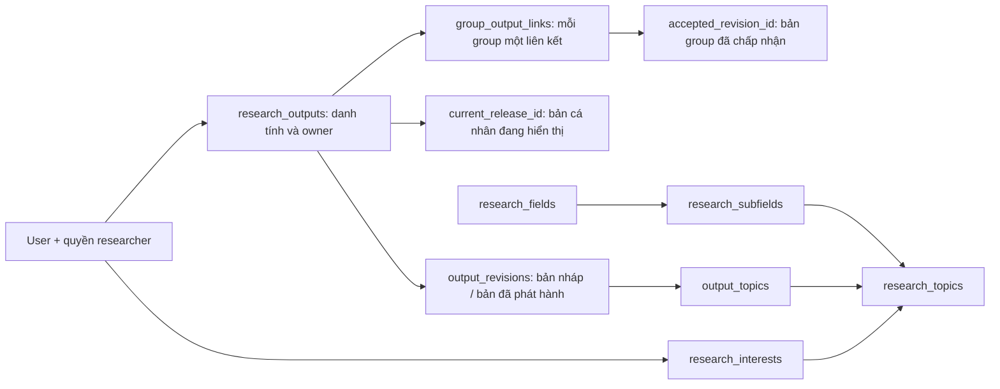

# ResearchOS database v4.3

Cập nhật ngày 30/10/2026. Bản 4.3 sửa bàn giao khi INSERT bị bỏ qua do trùng ID, chuẩn hóa whitespace đầu/cuối DOI, thêm khóa/chặn tạo session cho tài khoản inactive và partial index phục vụ thu hồi session/lịch sử bàn giao. Giữ policy STAFF/ADMIN, quyền researcher, công trình cá nhân độc lập group, taxonomy Other, đăng nhập LOCAL và OIDC cho tương lai. Đây là schema khởi tạo cho database mới, không phải migration và không áp dụng vào database đang có dữ liệu.

## File để dùng

- [DB-FLOWS.vi.md](DB-FLOWS.vi.md): giải thích dễ đọc theo thao tác người dùng, ví dụ xuyên suốt, bảng đọc/ghi và các phiên bản đang hiển thị. Nên đọc trước nếu mới tìm hiểu database.
- [ResearchOS.dbml](ResearchOS.dbml): copy **toàn bộ file** vào dbdiagram.io; tự chứa enum, bảng, FK và TableGroup.
- [ResearchOS.sql](ResearchOS.sql): SQL đầy đủ, gồm phần export DBML và bổ sung PostgreSQL.
- [postgres-features.sql](postgres-features.sql): nguồn của partial index, view, function và trigger; không chạy riêng trên database trống.
- [build-schema.ps1](build-schema.ps1): kiểm tra editor rồi tạo lại SQL bằng parser v2/exporter chính thức, lấy từ bộ `@dbml/cli@11.0.0`.
- [schema-tools.cjs](schema-tools.cjs): dùng `@dbml/parse` để lấy diagnostics giống editor và `@dbml/core` để parse/export. Có kiểm tra hồi quy cho FK đơn và FK ghép nullable.
- [schema-smoke.sql](schema-smoke.sql): kiểm tra nghiệp vụ, tự rollback fixtures.
- [schema-auth-smoke.sql](schema-auth-smoke.sql): kiểm tra STAFF/ADMIN, grant MANUAL/SYSTEM, credentials, session LOCAL/OIDC và không vượt quyền tài nguyên; tự rollback fixtures.
- [schema-policy-smoke.sql](schema-policy-smoke.sql): kiểm tra policy, DOI gồm tab/CR/LF, group singleton của sinh viên researcher, giữ nội dung khi inactive, bàn giao và conflict không gây đổi người thiếu lịch sử; tự rollback fixtures.
- [schema-search-smoke.sql](schema-search-smoke.sql): kiểm tra phần F0 mới: `output_import_state`, `field_provenance`, `search_index` (4 loại entity) và `owner_output_versions`; tự rollback fixtures.
- [schema-concurrency.py](schema-concurrency.py): kiểm tra bằng hai kết nối thật; **chỉ dùng database thử nghiệm**, fixtures được giữ lại.

DBML không biểu diễn đầy đủ partial index, trigger và chính sách truy vấn của PostgreSQL. Vì vậy dùng DBML để xem sơ đồ; dùng **ResearchOS.sql** khi tạo database. Không dùng riêng SQL export từ web rồi cho rằng đã có các ràng buộc bổ sung.

### Sửa thông báo nullable trong dbdiagram — 30/10/2026

Đã đổi 36 quan hệ tùy chọn từ `>` sang `>?`, gồm các FK đơn nullable và ba FK ghép có toàn bộ cột nullable. Giữ nguyên định nghĩa cột, FK, CHECK và quy tắc nghiệp vụ. Ví dụ `revoked_by` được NULL trước khi thu hồi quyền; `released_by` được NULL khi revision còn nháp; opportunity cá nhân vẫn không bắt buộc group/project.

Theo [cú pháp quan hệ DBML](https://dbml.dbdiagram.io/docs/#relationships--foreign-key-definitions), `>?` biểu diễn parent tùy chọn. Với FK ghép, bộ kiểm tra editor xét nullability của tuple; những tuple có cột bắt buộc giữ `>` nếu không có thông báo không khớp. SQL vẫn giữ hành vi FK PostgreSQL và các CHECK đi kèm.

Nguyên nhân kiểm tra cũ bỏ sót: export SQL/parse thành công chưa có nghĩa là editor không có diagnostics. Bộ diagnostics editor báo 75 vị trí (nhiều vị trí cùng trỏ tới một quan hệ), trong khi parser/export cũ vẫn chạy được. Parser cũ của lệnh `dbml2sql` cũng không nhận cú pháp `>?`, nên script build hiện dùng parser v2 và kiểm tra toàn bộ editor diagnostics trước khi export.

Riêng lần sửa cú pháp v4.0 đã kiểm chứng: 75 diagnostics trước sửa → **0 sau sửa**, SQL giữ nguyên khi bỏ comment/khoảng trắng. Bản 4.1 tiếp tục dùng kiểm tra editor này nhưng có thay đổi cấu trúc identity/auth theo bảng dưới. Kiểm chứng qua API diagnostics chính thức, chưa thao tác trên giao diện website.

## Thay đổi identity/auth ở v4.1

| Thành phần | Thay đổi | Ý nghĩa |
|---|---|---|
| `user_type` | Thêm STAFF | Nhân viên không tự thành researcher hoặc admin |
| `access_role` | Thêm ADMIN | Quyền quản trị tài khoản, độc lập RESEARCHER |
| `role_grant_source` | Thêm MANUAL / SYSTEM | Phân biệt người cấp với quy trình server tin cậy |
| `authentication_method` | Thêm LOCAL / OIDC | Session dùng chung, ghi rõ phương thức xác thực |
| `users.fptu_guid` | Nullable + unique | Chưa có mã trường đã xác minh thì để NULL |
| `users.email` | Trigger chuẩn hóa lower/trim, giữ unique | Định danh đăng nhập LOCAL duy nhất, không sao chép sang credentials |
| `users.academic_degree` | Thêm varchar(100) | Học vị ThS/TS; `academic_title` vẫn là học hàm GS/PGS |
| `user_role_assignments.role` | Bỏ default, phải ghi rõ | Không vô tình cấp RESEARCHER khi thiếu role |
| `user_role_assignments.grant_source` | NOT NULL, default MANUAL | Client không được tự chọn SYSTEM |
| `user_role_assignments.granted_by` | Nullable, FK `>?` | MANUAL bắt buộc có actor khác người nhận; SYSTEM bắt buộc NULL |
| `uq_active_researcher_grant` | Đổi thành `uq_unrevoked_user_role` | Một grant chưa thu hồi mỗi user/role, áp dụng cả ADMIN |
| `local_credentials` | Bảng mới, `user_id` PK/FK | Hash mật khẩu, mốc đổi mật khẩu, cờ bắt buộc đổi và timestamps |
| `user_sessions.auth_method` | NOT NULL, không default | Caller phải chỉ rõ LOCAL hay OIDC |
| `user_sessions.identity_id` | Nullable theo CHECK phương thức | LOCAL phải NULL; OIDC phải có identity đúng user |
| `user_sessions.user_id` | Thêm FK trực tiếp tới users | FK ghép OIDC không kiểm tra tuple khi identity NULL, nên cần FK này cho LOCAL |
| `effective_user_access` | Thêm `is_admin` | Cả hai quyền đều false khi inactive; chỉ tính grant đã tới ngày hiệu lực |
| Helper `is_admin(actor)` | Thêm | Dành cho policy quản trị; không được thêm bypass vào các helper owner/group/file |
| Trigger credentials | Stamp khi đổi hash + revoke session | Đổi/reset hash thu hồi mọi session chưa revoke của user, gồm LOCAL và OIDC |

Trong v4.1 không thêm bảng invitation/password-reset hoặc đăng ký công khai; những thay đổi v4.2 được mô tả dưới đây.

## Policy đã chốt và thay đổi v4.2

Giữ STAFF vì đây là loại tài khoản nhân viên, không phải role. STAFF active không có grant chỉ là guest; STAFF có ADMIN quản trị tài khoản, STAFF có RESEARCHER tham gia nghiên cứu, có thể được cấp cả hai. Không đổi nhân viên IT thành FACULTY để giải quyết quyền đăng nhập.

| Thao tác | Người được phép / quy tắc đã chốt |
|---|---|
| Tạo group | Mọi researcher active, gồm sinh viên/nhân viên đã được cấp quyền. Backend đặt chính actor làm `lead_id`; SQL kiểm tra leader là researcher active. Không yêu cầu thành viên tối thiểu |
| Cấp tài khoản | ADMIN dựa trên thông tin đã xác minh; user không tự chọn FACULTY/ADMIN |
| Sửa email, user_type, đơn vị | ADMIN kiểm tra căn cứ và ghi người/lý do ở log quản trị của backend. Đổi sang FACULTY tự phát sinh baseline researcher nên không dùng thay thao tác grant |
| Cấp/thu hồi RESEARCHER và ADMIN | ADMIN có thể cấp cho người khác, giữ lịch sử MANUAL; không tự cấp role; SYSTEM chỉ command server tin cậy |
| Khóa/mở tài khoản, revoke session, reset mật khẩu | ADMIN xác minh yêu cầu. Khóa tài khoản tự revoke session bằng trigger; mở lại không hồi sinh session cũ. Reset không cho đọc mật khẩu gốc |
| Bàn giao owner/Leader | ADMIN thực hiện theo đồng ý của người đang phụ trách hoặc xác nhận có thẩm quyền khi họ không còn phụ trách; người nhận phải là researcher active. Không tự chuyển tài nguyên về admin thực hiện |
| Xem application/private, sửa/phát hành bài, duyệt bài cho group | ADMIN không có quyền vượt policy tài nguyên. Application vẫn chỉ người gửi/người quản lý opportunity; bài/file/group vẫn kiểm tra owner/visibility/Leader |
| Duyệt taxonomy | Không có; Other tạo LOCAL hoạt động ngay. ADMIN không thêm một bước duyệt taxonomy |

Khi tài khoản inactive: giữ công trình đã chia sẻ, phiên bản, claim, group và các liên kết; không tự archive bài, tự xóa hay tự chuyển owner/Leader. Người khác vẫn đọc nội dung SHARED theo visibility. Người inactive không tiếp tục quản lý. Backend bàn giao có kiểm soát nếu cần tiếp tục vận hành tài nguyên.

MVP chỉ mở thao tác researcher chủ động thêm công trình mình có quyền quản lý, owner lấy từ actor xác thực. Tự động nhập hàng loạt công trình chưa có owner thuộc phase sau; giữ khả năng owner NULL cho thiết kế tương lai nhưng không cho SHARED. Claim tác giả không tự giao ownership.

### DOI trùng và công trình chưa có DOI

SQL chuẩn hóa DOI lowercase, loại bỏ whitespace đầu/cuối bằng `[[:space:]]` (gồm space/tab/CR/LF), bỏ một tiền tố `doi:`, `https://doi.org/`, `http://dx.doi.org/` hoặc biến thể cùng dạng, rồi trim đầu/cuối lần nữa trước unique. Áp dụng cho INSERT và UPDATE; chuỗi chỉ chứa whitespace thành NULL. Không xóa hoặc gộp ký tự bên trong DOI, không tự URL-decode hoặc cắt query/fragment. `10.1234/ABC` và URL DOI tương ứng, kể cả khi copy/paste có xuống dòng đầu/cuối, chỉ tạo được một công trình. Backend kiểm tra định dạng/chuẩn hóa tương ứng, xử lý unique violation và dùng lại bản ghi nếu người dùng có quyền xem. Có thể đề nghị claim tác giả, không tự cấp ownership hoặc sửa bài của người khác. Nếu bản ghi trùng là PRIVATE/không được xem, trả thông báo xung đột tối thiểu và hướng xử lý có thẩm quyền; không trả title, tác giả, owner hoặc file để làm lộ dữ liệu.

Không có DOI thì chỉ cảnh báo nghi trùng theo dữ liệu có sẵn; MVP không tự merge theo tên gần giống. Chuẩn hóa DOI không xác minh bài có tồn tại, không tải metadata hoặc gọi dịch vụ ngoài.

### Bàn giao và lịch sử

Bảng mới `resource_handovers` lưu một lần chuyển **owner của công trình hoặc Leader group**, với đúng một `output_id`/`group_id`; FK rõ ràng, không dùng ID đích đa hình không có FK. Ghi `previous_user_id`, `new_user_id`, `performed_by`, `performed_at`, `reason`, `basis` và `authorization_reference`.

- `HOLDER_CONSENT`: đồng ý đã xác minh của người đang phụ trách active.
- `INSTITUTIONAL_AUTHORIZATION`: xác nhận có thẩm quyền; bắt buộc dùng khi người cũ inactive. Backend xác minh căn cứ, không tin chuỗi reference do client tự gửi.
- INSERT vào bảng là thao tác bàn giao nguyên tử: `BEFORE INSERT` chỉ chuẩn hóa căn cứ/lý do và ghi thời gian DB. Row-level `AFTER INSERT` khóa hàng công trình/group bằng `FOR NO KEY UPDATE`, đối chiếu người cũ, kiểm tra actor khai báo là ADMIN active và người nhận researcher active, rồi cập nhật người phụ trách. Khóa này tuần tự hóa việc đổi người mà không xung đột với khóa `KEY SHARE` do FK của lịch sử lấy trên tài nguyên. Lỗi ở bất kỳ bước nào rollback cả việc đổi người và lịch sử.
- `ON CONFLICT(id) DO NOTHING` bỏ qua dòng lịch sử thì không chạy phần đổi owner/Leader. Đây chỉ là no-op an toàn ở DB, không phải xác nhận yêu cầu mới đã thành công: nếu API hỗ trợ retry theo ID, phải đối chiếu payload với log cũ và trả conflict khi cùng ID nhưng khác nội dung. Không dùng `DO UPDATE` để ghi đè lịch sử.
- UPDATE/DELETE lịch sử bị từ chối. Hai request có cùng người cũ: chỉ request đầu có thể thành công; request sau nhận lỗi người phụ trách đã đổi. Không tự retry bằng cách âm thầm thay người cũ.
- Chỉ đổi người phụ trách. Giữ nguyên revision, visibility, các link group, tác giả và claim. Group không tự thêm người cũ vào membership hoặc thêm recipient vào project. Người mới quản lý theo vai trò vừa nhận; admin thực hiện không nhận quyền tài nguyên/private.
- Backend bắt buộc đi qua thao tác này khi thay một owner/Leader đã có; không UPDATE trực tiếp `owner_id`/`lead_id` rồi ghi log rời rạc. SQL caller có quyền ghi trực tiếp vẫn có thể bypass luồng này: runtime DB roles/endpoint authorization chưa được triển khai. Không có trigger tự tạo log cho mọi UPDATE thủ công, cũng không phải audit tổng quát cho mọi thay đổi tài khoản.

```sql
-- Các tham số do backend xác thực/kiểm tra; không nhận actor hay căn cứ tùy ý.
INSERT INTO resource_handovers(output_id, previous_user_id, new_user_id,
  performed_by, basis, authorization_reference, reason)
VALUES (:output_id, :expected_owner, :recipient_id, :admin_id,
  'HOLDER_CONSENT', :verified_consent_reference, :reason);
-- Bàn giao group: dùng group_id thay output_id, người cũ là lead_id hiện tại.
```

### Không làm mất admin active cuối cùng

Backend phải bảo vệ cả thu hồi ADMIN, khóa/xóa tài khoản admin và những thao tác khác làm mất quyền admin hiệu lực. Một grant tương lai hoặc grant trên tài khoản inactive không được tính là admin thay thế. Admin cuối cùng phải bổ nhiệm admin active khác trước.

SQL cung cấp `assert_admin_removal_allowed(target_user)` lấy transaction advisory lock `(1920233327,1)` và kiểm tra còn admin active khác. Backend gọi **trước mutation trong cùng transaction READ COMMITTED**; mọi thao tác cấp/thu hồi ADMIN, đổi trạng thái tài khoản có ADMIN đều dùng cùng mutex, xác thực operator và kiểm tra lại quyền sau khi lấy khóa. Nếu dùng isolation cao hơn, cần xử lý retry phù hợp. Lời gọi helper tách khỏi transaction hoặc chỉ COUNT rồi UPDATE không bảo vệ được race.

```sql
BEGIN;
SELECT assert_admin_removal_allowed(:target_user);
-- Backend rechecks authenticated ADMIN permission while holding the mutex.
UPDATE user_role_assignments SET revoked_by=:admin_id, revoked_at=clock_timestamp()
WHERE user_id=:target_user AND role='ADMIN' AND revoked_at IS NULL;
COMMIT;
```

Đây là helper và hợp đồng transaction đã kiểm thử, **chưa phải API quản trị hoặc trigger tự chặn mọi raw SQL**. Bootstrap admin đầu tiên vẫn là command server tin cậy, không có endpoint công khai. Bảng grant giữ lịch sử cấp/thu hồi; các chỉnh sửa tài khoản/đơn vị và chứng cứ quản trị khác cần log backend khi triển khai, không được coi `resource_handovers` là sổ audit cho các thao tác đó.

## Mô hình chính và các quyết định



- Giáo viên active mặc định là researcher, không cần grant SYSTEM và không mặc định ADMIN. Sinh viên/nhân viên active mặc định là guest đã xác thực; grant RESEARCHER có hiệu lực cho họ cùng tính năng researcher như giáo viên. Thu hồi grant RESEARCHER bổ sung của giáo viên không loại bỏ quyền mặc định từ FACULTY.
- ADMIN phục vụ quản lý tài khoản/cấp và thu hồi role theo policy backend, không tự có RESEARCHER. Một người có thể có cả hai. ADMIN không tự là owner/Leader và không được bỏ qua visibility PRIVATE.
- Guest chỉ tìm kiếm/xem nội dung được phép; không follow, bật digest, tạo topic, đăng bài/cơ hội hoặc apply. Membership/profile không cấp researcher. Leader cũng không mặc nhiên có quyền cấp researcher cho người khác.
- MVP dùng **một owner quản lý mỗi công trình**, ở `research_outputs.owner_id`. `created_by` ghi nguồn tạo; `output_authors`/`publication_claims` ghi tác giả. Ba ý nghĩa này độc lập. Đồng tác giả không tự có quyền chỉnh sửa. Nếu sau này cần nhiều người cùng biên tập mới bổ sung ACL, hiện chưa thêm bảng này.
- Group chỉ cần Leader trong `research_groups.lead_id`, không cần hàng nào trong `group_members` và không đặt số thành viên tối thiểu. Không thêm giá trị LEAD vào role của membership.
- `group_directions` là hướng hoạt động có tiêu đề/mô tả riêng của nhóm, có thể gắn Topic; không đồng nhất direction với taxonomy.
- Không có Area Owner, hàng chờ duyệt taxonomy, hoặc duyệt bài toàn trường.
- Các module project/circle/research record/graph được giữ cho phase sau; không thêm chat, message hoặc vector storage.

## Đối chiếu schema cũ → mới

| Trước v4 | Sau v4 | Tác động |
|---|---|---|
| `major_research_areas` | `research_fields` | OpenAlex Field, không phải Domain |
| `research_areas` | `research_subfields` | OpenAlex Subfield |
| `research_areas.major_area_id` | `research_subfields.field_id` | FK Subfield → Field |
| `research_topics.area_id` | `research_topics.subfield_id` | FK Topic → Subfield |
| `code` ở hai cấp cha | `internal_code` | Mã nội bộ tùy chọn, khác ID nguồn |
| `name_en` ở hai cấp cha | `name` | Nhãn chính; giữ `name_vi` tùy chọn |
| Metadata nguồn thiếu ở Field/Subfield | `source`, `external_id`, `source_updated_at`, `last_synced_at` ở cả ba cấp | Nhận diện nhập liệu bằng `(source, external_id)` |
| `taxonomy_source = LOCAL/SCOPUS/OPENALEX` | `LOCAL/OPENALEX` | Hai nguồn hỗ trợ trong thiết kế hiện tại; thêm enum khi thực sự tích hợp nguồn khác |
| Unique tên Topic toàn bộ nguồn | Partial unique `(subfield_id, lower(name)) WHERE source='LOCAL'` | Chống trùng LOCAL; không merge hai ID nguồn hoặc LOCAL/imported chỉ vì trùng nhãn |
| Chưa có OIDC/session | `oidc_identities`, `oidc_login_attempts`, `user_sessions` | Danh tính SSO, giao dịch đăng nhập ngắn hạn và session ứng dụng |
| Metadata bài đặt tại `research_outputs` | Metadata chuyển vào `output_revisions` | Tách bản đang sửa khỏi bản đã đăng |
| Chưa có chủ thể quản lý riêng | `research_outputs.owner_id` | Owner + quyền researcher mới quản lý được bài |
| `research_outputs.publication_status` | `output_revisions.publication_status` | Trạng thái xuất bản học thuật của từng phiên bản |
| Chưa có trạng thái chia sẻ độc lập | `research_outputs.sharing_status` | DRAFT / SHARED / ARCHIVED, khác UNPUBLISHED / PUBLISHED trên tạp chí |
| Submission gắn group là cửa đăng bài | `output_revisions` + `current_release_id` | Phát hành cá nhân không cần group |
| `output_submissions` / `submission_status` | `group_output_links` / `group_output_status` | Chỉ xác nhận xuất hiện trên trang group; không chỉ đổi `group_id` thành nullable |
| Snapshot JSON submission | Metadata revision + `authors_snapshot`, `output_topics`, `output_revision_files` | Bản đã phát hành bất biến; topic/file phải thuộc đúng công trình |
| `output_topics(output_id, topic_id)` | `(revision_id, topic_id)` + `output_id` và composite FK | Topic nháp không lọt vào tìm kiếm bản đang chia sẻ |
| File chỉ gắn công trình | Thêm `output_revision_files` và scope file | Một file bất biến có thể dùng trong nhiều revision; tải file kiểm tra cả hai scope |
| `approved_output_releases` | `released_output_versions`, `group_output_releases` | Discovery cá nhân không còn JOIN bắt buộc group approval |
| `research_opportunities.type` / `opportunity_type` | `opportunity_kind` | 4 mục đích cơ hội, độc lập đối tượng |
| Chưa tách đối tượng | `target_audience` | FACULTY / STUDENT / ANY_RESEARCHER; chỉ lọc/matching |
| Opportunity `expected_role` enum | `varchar(255)` nullable | Tự nhập, chuẩn hóa khoảng trắng; không cấp quyền |
| `project_members.role` | Giữ `expected_role_type` | Không thay role của project thành text tự do |
| `expiration_date` | `application_deadline timestamptz` | Mốc nhận đơn chính xác, khác hạn phản hồi |
| Unique application cả lịch sử | Partial unique khi `status <> 'WITHDRAWN'` | Rút rồi nộp lại tạo hàng mới; đã phản hồi vẫn chặn nộp lại |
| `email_digest_queue` | `digest_deliveries` | Ledger theo user/kỳ tuần, có retry/lease/kết quả |
| Payload email tổng hợp khó truy vết | `research_updates`, `digest_items` | Sự kiện có ý nghĩa + nội dung/nguồn khớp, chống trùng công trình |
| `digest_frequency` / preference frequency | Bỏ, MVP cố định hàng tuần | Không còn lựa chọn ngày/tháng |
| Seminar chưa có mốc đăng | `research_seminars.published_at` | Phân biệt tạo nháp với đăng seminar |

Các FK, index, TableGroup và test đã dùng tên mới. `output_external_ids.source` vẫn có thể ghi nguồn metadata bài như SCOPUS/OPENALEX; đây không phải enum nguồn taxonomy.

## Flow đăng bài và liên kết group

### Trạng thái và phiên bản

`research_outputs` là một công trình duy nhất. `sharing_status` thể hiện việc chia sẻ trong trường:

| Trạng thái | Ý nghĩa |
|---|---|
| DRAFT | Chưa chia sẻ; chưa xuất hiện trong Discovery |
| SHARED | Có `current_release_id`, owner và `first_shared_at`; hiển thị theo visibility |
| ARCHIVED | Gỡ khỏi Discovery và mọi trang group, vẫn giữ dữ liệu và lịch sử phiên bản |

`output_revisions.released_at IS NULL` là bản sửa được. Khi owner phát hành, backend kiểm tra quyền, snapshot danh sách tác giả, hoàn thiện topic/file, rồi đặt `released_at/released_by` và đổi `current_release_id` **trong cùng transaction**. DB khóa metadata, topic và file associations của revision đã phát hành. Unique partial cho phép tối đa một bản nháp đang sửa trên mỗi công trình.

Khi sửa bài đã đăng, tạo revision mới bằng cách sao chép nội dung cần sửa và các liên kết topic/file. Giữ `sharing_status=SHARED` và con trỏ hiện tại. Sau phát hành mới, con trỏ cá nhân đổi; con trỏ của từng group vẫn giữ nguyên. `output_authors` dùng cho mapping/claim hiện tại; trang bài đã phát hành đọc `authors_snapshot`, không đọc danh sách mutable để hiển thị tác giả của phiên bản cũ.

`publication_status=UNPUBLISHED/PUBLISHED` trong revision nói về tạp chí/hội nghị; một preprint UNPUBLISHED vẫn có thể SHARED nội bộ. DOI là danh tính công trình dùng chung. Sửa DOI, owner và mapping nguồn là thao tác metadata có kiểm soát ở backend, không phải sửa nội dung revision.

### A. Researcher không thuộc group

1. A tạo `research_outputs(owner_id=A, sharing_status=DRAFT)` và revision 1; không cần group.
2. A thêm topic có sẵn hoặc tạo LOCAL qua Other, upload file và chọn visibility.
3. A bấm đăng: backend xác thực A là owner + researcher, phát hành revision 1 và đặt `current_release_id`.
4. Bài có thể xuất hiện trong Discovery nội bộ ngay nếu visibility cho phép. Không tạo `group_output_links`.

### B. Thành viên đề nghị đưa bài vào group

1. Thành viên có quyền researcher chọn một revision **đã phát hành** của bài đang SHARED và mình được xem.
2. Tạo/cập nhật `group_output_links(output_id, group_id)` với `requested_revision_id`, `requested_by`, `status=PENDING`. Bản thiết kế cho phép thành viên đề nghị một bài được xem, dù không phải owner; đề nghị không cấp quyền sửa bài.
3. Leader chấp nhận: ghi `accepted_revision_id=requested_revision_id`, người/thời điểm chấp nhận và `status=ACCEPTED`.
4. Nếu yêu cầu cập nhật sang revision mới còn PENDING hoặc bị REJECTED, giữ pin đã chấp nhận trước đó. Vì thế truy vấn trang group xét **accepted_revision_id khác NULL**, không chỉ `status=ACCEPTED`.

### C. Leader của group một người

Leader đăng bài cá nhân như A. Nếu đó là bài mình quản lý, Leader có thể tạo liên kết ACCEPTED trực tiếp với chính group mình dẫn dắt. Không phải gửi đơn rồi tự duyệt, không cần thêm thành viên giả.

### D. Một bài trong hai group

Một hàng `research_outputs`, nhiều hàng `group_output_links`, khóa chính `(output_id, group_id)`. Group G1 có thể giữ revision 1, G2 giữ revision 2. Từ chối cập nhật ở G1 không làm G2 đổi phiên bản. Gỡ khỏi G1 đặt REMOVED và xóa pin được chấp nhận của **liên kết G1**, không DELETE công trình hoặc liên kết G2.

Đây là mô hình lưu **trạng thái hiện tại** của yêu cầu mỗi group, không phải sổ mọi lần quyết định. Giữ danh tính revision và sự kiện chấp nhận trong `research_updates`; chưa thêm bảng lịch sử toàn bộ review/rejection. Các thao tác đổi trạng thái phải dùng điều kiện so sánh revision/status hiện tại để tránh thao tác từ màn hình cũ ghi đè quyết định mới.

### Visibility và Discovery

Scope hiện tại của công trình áp dụng cho mọi revision, kể cả revision group đang giữ. `RESEARCH_GROUP` dùng `access_group_id` rõ ràng; link sang group khác không cấp quyền xem. `PRIVATE` chỉ owner được xem. Group Leader không tự xem được file riêng của owner. Archive công trình ẩn ở mọi group nhưng giữ các pin, nên khôi phục SHARED sẽ làm các pin hợp lệ hiển thị lại theo visibility.

Các view nền **không tự lọc theo người đang đăng nhập**. Backend dùng actor lấy từ session đã xác thực với các hàm sau; không nhận actor tùy ý từ request:

```sql
-- Bài cá nhân đã đăng, lọc quyền xem; không phụ thuộc group approval.
SELECT * FROM visible_output_releases(:actor_id);

-- Lọc taxonomy CHỈ trên revision đang hiển thị.
SELECT r.* FROM visible_output_releases(:actor_id) r
WHERE EXISTS (SELECT 1 FROM output_topics ot
              WHERE ot.revision_id=r.revision_id AND ot.topic_id=:topic_id);

-- Trang group đọc revision đã chấp nhận, vẫn kiểm tra visibility bài.
SELECT * FROM visible_group_output_releases(:actor_id, :group_id);

-- Chỉ tạo signed URL ngắn hạn khi kết quả true.
SELECT can_view_output_file(:actor_id, :file_id);
```

File cần thuộc revision cá nhân đang hiển thị hoặc một pin group đang hoạt động, trừ owner xem file nháp của mình; đồng thời phải được phép ở cả scope công trình và scope file, `is_available=true`. Storage phải giữ private, không dùng URL công khai bỏ qua kiểm tra. File không được thay payload/storage_key tại chỗ; upload file mới cho revision mới.

## Taxonomy và interest

Chọn ba cấp cuối trong [taxonomy OpenAlex](https://help.openalex.org/data/topics/): **Field → Subfield → Topic**. Không đưa Domain vào cây chính.

Mỗi cấp có UUID nội bộ, `source`, `external_id`, `source_updated_at`, `last_synced_at`. `source_updated_at` để NULL khi nguồn không cung cấp timestamp tin cậy. `internal_code` ở hai cấp cha là mã FPTU tùy chọn, không dùng làm ID OpenAlex. Quy ước worker: lưu external_id dạng canonical URL OpenAlex đầy đủ; không trộn URL và ID rút gọn của cùng đối tượng.

Flow đồng bộ thiết kế:

1. Upsert Field theo `(source, external_id)`, lấy UUID nội bộ.
2. Upsert Subfield bằng ID nguồn, resolve `field_id` từ ID Field do nguồn trả về.
3. Upsert Topic bằng ID nguồn, resolve `subfield_id` tương tự.
4. Cập nhật tên/metadata/timestamp trên hàng đó; không lookup tên để chọn hàng update. Lặp lại không tạo thêm node.
5. Nguồn mất một node thì đánh dấu inactive theo chính sách sync, không hard-delete. FK RESTRICT ngăn xóa node đang được tham chiếu. Không cascade xóa cây.
6. Mọi câu lệnh đồng bộ giới hạn `source='OPENALEX'`. Không UPDATE/DELETE LOCAL, không tự merge theo tên. Trigger bảo vệ không đổi source/external_id của đối tượng đã tồn tại; quyền database cho worker cần giới hạn khi triển khai, không dùng tài khoản owner schema.

Ví dụ upsert Topic, sau khi worker resolve đúng parent:

```sql
INSERT INTO research_topics(subfield_id,name,source,external_id,last_synced_at,source_updated_at)
VALUES (:subfield_uuid,:name,'OPENALEX',:openalex_url,clock_timestamp(),:upstream_updated_at)
ON CONFLICT(source,external_id) DO UPDATE
SET subfield_id=EXCLUDED.subfield_id, name=EXCLUDED.name,
    last_synced_at=EXCLUDED.last_synced_at, source_updated_at=EXCLUDED.source_updated_at;
```

Other: researcher chọn Subfield, nhập tên; tạo Topic LOCAL với `created_by`, không có external_id. Trigger chuẩn hóa khoảng trắng, từ chối tên rỗng và creator không có researcher, cho hoạt động ngay. Partial unique chống trùng LOCAL không phân biệt hoa/thường trong cùng Subfield. Hai researcher tạo cùng tên đồng thời: một insert thành công, insert kia nhận unique violation; API trả topic đã có để người dùng chọn.

LOCAL và imported cùng tên được giữ riêng. Hai imported có ID khác nhau nhưng cùng tên cũng được giữ riêng. UI hiển thị nguồn/parent để phân biệt và có thể gợi ý dùng topic sẵn có, không merge tự động. Đây là cách tránh việc sync đổi tên vô tình bị chặn hoặc ghi đè LOCAL. Chuẩn hóa Unicode NFC và gợi ý gần giống thuộc backend; DB hiện chuẩn hóa whitespace + lower, không bỏ dấu để nhập nhằng các tên khác nhau.

`output_topics` mô tả nội dung revision, còn `research_interests` mô tả người dùng:

| Tình huống | source_type | status |
|---|---|---|
| Người dùng tự chọn bất kỳ Topic, kể cả từ OpenAlex | DECLARED | ACTIVE |
| Hệ thống suy luận từ công trình | INFERRED | SUGGESTED |
| Người dùng chấp nhận suy luận | Giữ INFERRED | ACTIVE |
| Người dùng từ chối | Giữ nguồn suy luận | REJECTED |

Không xóa negative feedback để tránh suy luận lại liên tục. Onboarding researcher không có publication vẫn hoàn tất sau khi xác nhận không có bài phù hợp và chọn ít nhất một interest ACTIVE. Guest chỉ xem; backend không ép guest thực hiện bước ghi interest dành cho researcher.

**Chưa có worker OpenAlex hoặc suy luận interest trong thay đổi này.** Schema và test dùng dữ liệu giả, không gọi API OpenAlex.

## Đăng nhập LOCAL cho MVP, OIDC cho tương lai

Các bảng phục vụ các vòng đời khác nhau:

| Bảng | Nội dung | Khóa/ràng buộc chính |
|---|---|---|
| `users` | Tài khoản được cấp sẵn/mời, email chuẩn hóa và loại tài khoản | UUID nội bộ; email unique; fptu_guid nullable + unique |
| `local_credentials` | Hash mật khẩu, yêu cầu đổi mật khẩu ban đầu/reset | `user_id` PK/FK, không lặp email/username |
| `oidc_identities` | Mapping tài khoản FPTU tới OIDC issuer/subject | Unique `(issuer,subject)`; không dùng email để định danh SSO |
| `oidc_login_attempts` | Lần bắt đầu login, sống ngắn | Hash state/nonce/browser binding; verifier PKCE mã hóa; hạn dùng và mốc consumed |
| `user_sessions` | Phiên ứng dụng cho cả LOCAL và OIDC | FK user trực tiếp, composite FK identity/user; CHECK auth_method; hash token unique; hạn tuyệt đối/idle và thu hồi |

### Cấp tài khoản và đăng nhập LOCAL

1. Người có thẩm quyền tạo `users` theo danh sách/mời đã xác minh; server kiểm soát `user_type`. Người dùng không tự chọn FACULTY/ADMIN. Chưa biết `fptu_guid` thì để NULL, không bịa mã. Email được SQL chuẩn hóa lowercase/trim; backend áp dụng cùng chuẩn hóa khi lookup và kiểm tra định dạng email.
2. Backend tạo mật khẩu tạm ngẫu nhiên, dùng thư viện hash mật khẩu một chiều có salt và chi phí phù hợp, chỉ ghi **password_hash** vào `local_credentials`. Không ghi mật khẩu gốc, mật khẩu mã hóa có thể giải mã, log hoặc response tùy ý. Schema không thể chứng minh một chuỗi là hash an toàn: việc hash/verify thuộc thư viện backend.
3. `must_change_password=true` mặc định. Quy trình cấp/mời gửi thông tin ban đầu qua kênh được kiểm soát; chưa triển khai seed, invitation delivery hoặc bảng token reset trong phạm vi này.
4. Khi nhập email/mật khẩu, backend bắt đầu transaction READ COMMITTED, khóa `users` trước rồi `local_credentials` theo hợp đồng bên dưới, kiểm tra active và verify hash vừa đọc. Sai tài khoản/mật khẩu không tạo session. Cần rate limit, phản hồi lỗi thống nhất và bảo vệ bí mật ở backend.
5. Xác thực thành công mới tạo `user_sessions(auth_method='LOCAL', identity_id=NULL)` và cookie opaque. Không tạo một OIDC identity giả. Chỉ lưu hash token trong DB; TTL tuyệt đối/idle do server thiết lập.
6. Với LOCAL có `must_change_password=true`, session chỉ được vào flow đổi mật khẩu/đăng xuất cần thiết; middleware chặn các API nghiệp vụ và quản trị cho đến khi đổi xong. View `active_user_sessions` chỉ kiểm tra hiệu lực session/tài khoản, **không thay middleware bắt buộc đổi mật khẩu**.
7. Mỗi request lấy actor từ session hợp lệ rồi đọc quyền hiện tại. Không cache role trong session, không suy ra quyền từ đuôi email.

### Đổi, reset mật khẩu và logout

- Đổi tự phục vụ: backend xác minh mật khẩu hiện tại hoặc tái xác thực theo policy, kiểm tra mật khẩu mới, ghi hash mới và `must_change_password=false` trong transaction. Trigger ghi `password_changed_at`, cập nhật timestamp và revoke mọi session chưa thu hồi của user, kể cả session đang thực hiện và session OIDC nếu có. Sau commit yêu cầu đăng nhập lại.
- Reset có thẩm quyền: admin/procedure server kiểm tra policy, tạo hash mới và đặt `must_change_password=true`; cùng trigger thu hồi session cũ. ADMIN được khởi động quy trình reset theo policy nhưng không được đọc mật khẩu gốc (DB không lưu nó). Chưa có endpoint reset thực tế.
- Logout: cập nhật `revoked_at` và lý do trên session hiện tại, xóa cookie; logout tất cả cập nhật mọi session của user. Đổi mật khẩu không thể chỉ xóa cookie trên một thiết bị.
- Inactive: view session và hai helper role không cho sử dụng sau khi deactivation commit dù session chưa tới hạn. Trigger revoke session trong cùng transaction khi `is_active` đổi true → false, giữ lý do ACCOUNT_DEACTIVATED. `BEFORE INSERT` trên session lấy khóa `users FOR SHARE`, đọc lại active sau khi chờ và từ chối user inactive cho cả LOCAL/OIDC. Với READ COMMITTED: nếu login insert trước thì deactivation chờ rồi revoke phiên đó; nếu deactivation trước thì insert chờ rồi bị từ chối. Mở lại tài khoản không hồi sinh phiên cũ.
- Tránh race login/reset: backend lấy khóa theo thứ tự **users → local_credentials → user_sessions**, giữ đến commit. Đọc và verify hash sau khi lấy khóa credentials; đổi/reset mật khẩu cũng tuân thủ thứ tự này. Không verify bên ngoài transaction rồi insert session bằng kết quả cũ. Session guard không tự chứng minh mật khẩu đúng hoặc hash chưa đổi.
- Hash rehash cũng kích hoạt revoke vì DB nhận diện bằng thay đổi hash. Nếu sau này muốn tối ưu policy rehash thì cần thiết kế rõ; hiện ưu tiên hành vi nhất quán.

### Hợp đồng transaction cho login và quản trị tài khoản

Các flow này dùng **READ COMMITTED**; chưa bảo đảm hành vi tương đương nếu đổi sang REPEATABLE READ chỉ bằng cách retry. Các thao tác quản trị ảnh hưởng ADMIN lấy mutex admin trước, sau đó mới khóa user. Khi khóa nhiều user, dùng thứ tự UUID nhất quán. LOCAL login/đổi/reset mật khẩu dùng cùng thứ tự khóa dưới đây:

```sql
BEGIN ISOLATION LEVEL READ COMMITTED;
SELECT id, is_active FROM users WHERE id=:user_id FOR UPDATE;
-- Backend từ chối nếu không có user hoặc inactive.
SELECT password_hash, must_change_password FROM local_credentials
WHERE user_id=:user_id FOR UPDATE;
-- Backend verify hash vừa đọc; thất bại thì ROLLBACK, không tạo session.
-- Thành công: INSERT user_sessions với hash token và TTL do server tạo.
COMMIT;
```

OIDC xác minh token/state/identity trước theo flow SSO, rồi trong transaction khóa user, kiểm tra active, consume attempt và tạo session; không cần tạo/khóa credentials giả. Đổi/reset mật khẩu khóa user trước credentials và UPDATE hash; deactivation khóa user qua UPDATE và revoke sessions. Guard session `FOR SHARE` là lớp bảo vệ cuối cho INSERT, không thay các bước verify, authorization hoặc thứ tự khóa của backend. Chưa triển khai API login/reset/OIDC thực tế.

### Index phục vụ session và bàn giao

| Index PostgreSQL | Mục đích |
|---|---|
| `idx_unrevoked_sessions_user (user_id) WHERE revoked_at IS NULL` | Tìm các phiên cần revoke mà không quét toàn bộ lịch sử của user; giữ index `(user_id, expires_at)` cho tra cứu theo hạn |
| `idx_handover_output_history (output_id, performed_at) WHERE output_id IS NOT NULL` | Lịch sử công trình, không chứa các dòng bàn giao group |
| `idx_handover_group_history (group_id, performed_at) WHERE group_id IS NOT NULL` | Lịch sử group, không chứa các dòng bàn giao công trình |

Hai index lịch sử partial thay hai index toàn bảng tương ứng, không tạo thêm bản sao. DBML ghi chú chúng; định nghĩa thực nằm trong `postgres-features.sql` và SQL sinh ra. Đây là lựa chọn theo điều kiện truy vấn, chưa phải kết quả benchmark tải. Khi có dữ liệu đại diện, dùng `EXPLAIN (ANALYZE, BUFFERS)` để đánh giá; không thêm index hàng loạt chỉ vì có FK.

### ADMIN và grant MANUAL/SYSTEM

`effective_user_access` cung cấp `is_researcher` và `is_admin` độc lập. Inactive làm cả hai false. Grant chỉ có hiệu lực khi `granted_at <= CURRENT_TIMESTAMP` và chưa revoked; revoke giữ hàng lịch sử. Một hàng grant ADMIN không được dùng thay `can_manage_output`, `can_manage_group` hoặc `can_view_output_file`.

MANUAL bắt buộc actor khác user nhận; backend lấy actor từ session ADMIN đủ quyền và kiểm tra policy cấp/thu hồi role (bao gồm ADMIN). CHECK chỉ xác nhận hình dạng dữ liệu, **không xác thực người kết nối SQL thực sự là admin**. Client không được điều khiển `granted_by`, `grant_source`, `granted_at` hoặc tự cấp role.

SYSTEM dành cho command/seed server tin cậy, ví dụ bootstrap admin đầu tiên: tạo user theo loại tài khoản thực tế, credentials tạm nếu đăng nhập LOCAL, rồi grant `role=ADMIN, grant_source=SYSTEM, granted_by=NULL`. Không có endpoint bootstrap công khai. Seed/command này chưa được triển khai. Không tạo SYSTEM RESEARCHER cho toàn bộ giáo viên vì FACULTY đã có baseline researcher.

Khi revoke, ghi người thực hiện và thời gian; hệ thống yêu cầu `revoked_by` khác NULL nếu đã revoke, kể cả grant ban đầu được SYSTEM cấp. ADMIN không tự được quyền researcher và STAFF không tự được ADMIN. Quyền cấp ADMIN và hợp đồng chống mất admin cuối cùng theo policy v4.2 phía trên; endpoint xác thực và quy trình reset vẫn cần backend triển khai.

### OIDC sau này dùng cùng tài khoản

Flow dự kiến dùng Authorization Code + PKCE S256 theo [OIDC Core](https://openid.net/specs/openid-connect-core-1_0.html) và [RFC 7636](https://www.rfc-editor.org/rfc/rfc7636):

1. Backend tạo state/nonce/verifier ngẫu nhiên, browser binding và giao dịch login ngắn hạn. Khóa mã hóa verifier nằm ngoài database; issuer/client ID/secret/redirect URI nằm trong cấu hình server tin cậy.
2. Callback xác minh browser binding và atomically consume giao dịch chưa hết hạn; trả 0 hàng nghĩa là hết hạn/đã dùng/sai binding. Consume trước bước exchange, lỗi exchange yêu cầu bắt đầu login lại.
3. Đổi authorization code tại token endpoint; kiểm tra issuer, chữ ký/JWKS, audience/azp khi áp dụng, expiry và nonce. Liên kết identity đã xác minh vào **users.id hiện có**, giữ chung hồ sơ/công trình với LOCAL. Không tự tạo user thứ hai chỉ vì bật SSO, không tự link theo email trùng; trường hợp chưa mapping phải qua quy trình xác minh/provisioning được phép.
4. Tạo `user_sessions(auth_method='OIDC', identity_id=...)`; identity phải thuộc đúng user qua composite FK. Tạo opaque cookie, chỉ lưu hash. Cookie HttpOnly/Secure/SameSite phù hợp callback; CSRF protection cho thao tác ghi. Không lưu raw authorization code, ID/access/refresh token trong schema này.
5. Mỗi request kiểm tra session còn hạn/không bị revoke, user active và quyền hiện tại từ `effective_user_access`. Grant/revoke có hiệu lực ngay, không cache role trong session. Logout revoke; rotation tạo session mới và revoke session cũ.

```sql
-- Sau khi kiểm tra callback/browser binding; tất cả tham số do backend quản lý.
UPDATE oidc_login_attempts SET consumed_at=clock_timestamp()
WHERE state_hash=:state_hash AND browser_binding_hash=:binding_hash
  AND consumed_at IS NULL AND expires_at>clock_timestamp()
RETURNING issuer,redirect_uri,pkce_verifier_ciphertext,encryption_key_id,nonce_hash;
```

`active_user_sessions` hỗ trợ truy vấn hiệu lực cho cả hai phương thức; backend tra theo hash cookie, không cung cấp nguyên view cho client. Có `idp_sid` để tích hợp logout của IdP sau này. TTL, IdP FPTU/client registration, claim mapping, token validation, cookie và cleanup attempts/sessions là cấu hình/logic triển khai. **Chưa có API login LOCAL, password hashing/verification thực tế, bootstrap admin hoặc tích hợp SSO thật.**

## Opportunity và application

- Tạo DRAFT, kể cả cá nhân không có group/project. DB không cho insert trực tiếp OPEN; publish bằng update sau kiểm tra dữ liệu, hạn nhận còn tương lai và chưa archive.
- Cá nhân: creator quản lý. Có group: phải có quyền quản lý group. Có project: phải là lead project active; có cả hai thì kiểm tra cả hai và project phải thuộc đúng group. `creator_id` không vượt qua scope. MVP chưa có ủy quyền quản lý bổ sung.
- `opportunity_kind`: RESEARCH_COLLABORATION / PROJECT_FORMATION / DATA_METHOD_EXCHANGE / FUNDING_CALL. `target_audience` là bộ lọc/matching; không cấp quyền researcher và không chặn theo user_type thay cho quyền thật.
- `expected_role` tự nhập tối đa 255 ký tự, nullable; chuẩn hóa whitespace, chuỗi rỗng thành NULL. `required_expertise_tags` riêng biệt. Role project giữ enum cũ.
- Insert application khóa hàng opportunity `FOR SHARE`, kiểm tra OPEN, cutoff, archive và researcher. Khóa này phối hợp với thao tác đóng để không insert dựa vào trạng thái OPEN đã cũ.
- `applied_at` lấy thời gian DB; `response_due_at` chụp SLA theo **ngày lịch** tại Asia/Ho_Chi_Minh, gồm cuối tuần/ngày lễ. Sửa SLA sau này không thay deadline đơn cũ.
- Chỉ PENDING chuyển một lần sang WITHDRAWN / INVITED_TO_DISCUSS / DECLINED. Đã terminal không sửa lại hoặc xóa. Chỉ applicant được rút: backend bắt buộc actor trùng applicant trong WHERE.
- Rút rồi gửi lại tạo **ID mới**, timestamp/SLA/note mới, giữ hàng WITHDRAWN cũ. Partial unique `(opportunity_id,applicant_id) WHERE status<>'WITHDRAWN'` ngăn hai đơn chưa rút; INVITED_TO_DISCUSS/DECLINED vẫn chiếm khóa này.
- Đóng/hết hạn không auto-decline; người có quyền vẫn phản hồi đơn đang PENDING. INVITED_TO_DISCUSS không tự thêm membership. Archive giữ lịch sử.
- `visible_opportunity_applications(actor)` chỉ trả đơn của người gửi hoặc người có quyền xử lý đang là researcher. API không trả inbox/application từ bảng gốc cho người khác. Email phản hồi là thông báo giao dịch độc lập digest; chưa triển khai delivery của thông báo này.

```sql
-- Rút đúng lần nộp, chỉ chính applicant; actor do backend xác thực.
UPDATE opportunity_applications SET status='WITHDRAWN'
WHERE id=:application_id AND applicant_id=:actor_id AND status='PENDING'
RETURNING id;

-- Phản hồi đúng ID hiện tại, không update theo opportunity+applicant chung chung.
UPDATE opportunity_applications
SET status='INVITED_TO_DISCUSS',responded_by=:actor_id,response_note=:note
WHERE id=:application_id AND status='PENDING'
RETURNING id;
```

Hai thao tác đồng thời: row lock + điều kiện PENDING khiến chỉ một update thắng; bên còn lại nhận 0 hàng. API trả trạng thái mới cho client, không coi 0 hàng là thành công. Các kiểm tra quyền cần chạy trong transaction ghi; nếu thay owner/leader/grant đồng thời, backend khóa các hàng quyền liên quan theo thứ tự nhất quán hoặc dùng isolation/retry phù hợp.

## Follow, sự kiện và digest

`user_follows` giữ đích đa hình RESEARCHER/GROUP/TOPIC/PROJECT/OUTPUT. Không có FK tới từng đích: backend phải kiểm tra tồn tại, quyền xem, module đã mở và xử lý archive/xóa. Follow không cấp quyền xem.

`research_updates` là ledger nhỏ cho các hành động chia sẻ có ý nghĩa, không phải event bus tổng quát. Trigger ghi cùng transaction khi chia sẻ cá nhân lần đầu, đổi revision cá nhân, chấp nhận pin group, mở opportunity lần đầu, đăng seminar. Project phase sau ghi sự kiện có ý nghĩa rõ ràng. Update tên/updated_at/sync thông thường không tạo event. Unique event_key giúp không nhân event khi lặp thao tác; mở lại cùng opportunity hoặc gỡ/rồi gắn lại cùng group+revision không gửi thông báo mới trong MVP.

`digest_deliveries` có unique user/kỳ, trạng thái, attempts 0..5, next_attempt_at, locked_until và kết quả nhà cung cấp. `digest_items` unique `(delivery_id,subject_type,subject_id)` nên một bài khớp nhiều group/topic/researcher/follow chỉ có một item. Trigger suy ra subject từ event; worker hợp nhất `matched_reasons`, chọn event/phiên bản phù hợp và giữ `content_snapshot` cho truy vết. Chỉ một event đại diện/item, không lưu bảng riêng cho mọi event đã gộp.

Worker khi triển khai phải thực hiện:

1. Theo tuần lịch và timezone preference, dùng cửa sổ nửa mở `[period_start,period_end)`, dựa `occurred_at`, không dựa ngày tạo bài. Matching bằng **topic của revision đã phát hành**, group pin và các đối tượng theo dõi thực sự. Không tự đưa private/draft vào payload.
2. Lọc đúng quyền, active researcher, opt-in. Không có item phù hợp thì không tạo delivery. Dựng delivery/items trong transaction; unique window tránh job tạo trùng.
3. Claim job bằng `FOR UPDATE SKIP LOCKED` hoặc conditional update trên PENDING/FAILED đến hạn; tăng attempts, đặt lease tương lai. Không claim lease PROCESSING chưa hết hạn. DB không thay thế scheduler.
4. Ngay trước gửi, kiểm tra lại quyền tài khoản/opt-out/visibility và revision được phép xem, prune item không còn hợp lệ, làm mới snapshot nếu cần. Nếu rỗng thì CANCELLED, không gửi email rỗng. DB có guard về role/opt-in/nonempty ở lúc PROCESSING/SENT; nội dung JSON và quyền nội dung từng item vẫn thuộc worker.
5. Dùng delivery UUID làm idempotency key nếu provider hỗ trợ. Sau timeout không biết provider đã nhận chưa: reconcile bằng key/message ID, không gửi lại mù. Nếu provider không hỗ trợ chống trùng, cần trạng thái FAILED và xử lý kết quả không chắc chắn trước retry; không bảo đảm exactly-once email chỉ bằng DB.
6. Retry có backoff và tối đa 5 lần; lease hết hạn cho phép phục hồi worker chết nhưng phải reconcile kết quả provider trước. SENT/CANCELLED là terminal, item không sửa sau terminal. Serialize việc chuẩn bị payload để một worker không đổi snapshot trong khi worker khác đang gửi.
7. Cần reconciliation cho event commit muộn quanh ranh giới kỳ gửi; không dùng mỗi `MAX(occurred_at)` làm watermark tuyệt đối. Nếu kỳ đã gửi, chuyển các event muộn chưa thực sự được giao sang kỳ kế tiếp sau đối soát item/snapshot. Quy trình này chưa được triển khai/test end-to-end trong schema.

Opt-out/quyền thay đổi sau khi email đã gửi không thể thu hồi email. Thời điểm gửi phải recheck và chọn nội dung tối thiểu cần thiết; retry không tự khắc phục mọi cửa sổ lỗi mạng.

## Vai trò từng bảng

| Nhóm | Bảng | Trách nhiệm |
|---|---|---|
| Identity | `users` | FACULTY/STUDENT/STAFF, email đăng nhập, active, mã trường tùy chọn, học hàm/học vị |
| Identity | `user_role_assignments` | Lịch sử grant/revoke RESEARCHER/ADMIN, nguồn MANUAL/SYSTEM; partial unique mỗi user/role |
| Identity | `local_credentials` | Hash mật khẩu cho MVP, mốc đổi, cờ bắt buộc đổi mật khẩu ban đầu/reset |
| Identity | `researcher_profiles` | Hồ sơ, ORCID, onboarding; không cấp quyền |
| Identity | `oidc_identities` | Mapping issuer/subject đã xác minh |
| Identity | `oidc_login_attempts` | Giao dịch login ngắn hạn, chống replay bằng consume có điều kiện |
| Identity | `user_sessions` | Session LOCAL/OIDC dùng chung, hạn và revoke; không snapshot role |
| Taxonomy | `research_fields` | OpenAlex Field |
| Taxonomy | `research_subfields` | Subfield thuộc một Field |
| Taxonomy | `research_topics` | Topic thuộc một Subfield; LOCAL/OPENALEX |
| Taxonomy | `research_interests` | Quan tâm của user, nguồn khai báo/suy luận và phản hồi |
| Publications | `research_outputs` | Một danh tính công trình, owner, visibility, current release |
| Publications | `output_revisions` | Nội dung phiên bản, authors snapshot, mốc phát hành |
| Publications | `output_external_ids` | ID metadata công trình tại các nguồn ngoài |
| Publications | `output_authors` | Tác giả nội/ngoại bộ và mapping tài khoản hiện tại |
| Publications | `publication_claims` | Xác nhận/từ chối gợi ý tác giả; không cấp quyền sửa |
| Publications | `output_topics` | Topic của một revision |
| Publications | `output_files` | File storage bất biến, scope và availability |
| Publications | `output_revision_files` | File thuộc revision nào, composite FK cùng công trình |
| Publications | `group_output_links` | Đề nghị và pin revision đã chấp nhận của từng group |
| Publications | `achievement_posts` | Tin/thành tựu; không thay cơ chế phát hành bài |
| Groups | `research_groups` | Profile group và nguồn duy nhất xác định Leader |
| Groups | `group_members` | Thành viên ngoài vai trò leader; không cấp researcher |
| Groups | `group_directions` | Hướng nghiên cứu riêng của group, có thể gắn Topic |
| Opportunities | `research_opportunities` | Cơ hội cá nhân/group/project, cutoff và SLA |
| Opportunities | `opportunity_applications` | Mỗi lần apply/rút/phản hồi, giữ lịch sử |
| Seminars | `research_seminars` | Seminar, organizer là user, affiliation group tùy chọn |
| Administration | `resource_handovers` | Lịch sử bất biến và thao tác bàn giao owner/Leader nguyên tử, kèm căn cứ đã xác minh |
| Follow/digest | `user_follows` | Follow đích đa hình |
| Follow/digest | `digest_preferences` | Opt-in hàng tuần, timezone/ngôn ngữ |
| Follow/digest | `research_updates` | Sự kiện chia sẻ có ý nghĩa cho matching |
| Follow/digest | `digest_deliveries` | Một lượt gửi mỗi user/kỳ và trạng thái retry |
| Follow/digest | `digest_items` | Nội dung được chọn, event đại diện, nhiều lý do khớp |
| Phase sau | `research_projects` | Project, lead và group/direction tùy chọn |
| Phase sau | `project_members` | Thành viên project độc lập group membership |
| Phase sau | `project_milestones` | Mốc công việc của project |
| Phase sau | `mentoring_records` | Hướng dẫn sinh viên/đề tài |
| Phase sau | `interest_circles` | Nhóm quan tâm sơ khởi, có thể nâng thành group |
| Phase sau | `interest_circle_members` | Thành viên circle |
| Phase sau | `research_records` | Ghi chép nghiên cứu có cấu trúc, không phải publication |
| Phase sau | `record_lineage` | Liên hệ kế thừa giữa record |
| Phase sau | `knowledge_graph_edges` | Quan hệ tri thức đa hình; không bắt buộc cho AI search |

## Database bảo vệ gì, backend còn phải làm gì?

| Database hiện bảo vệ | Backend/worker phải thực hiện |
|---|---|
| FK/unique/CHECK, đúng parent và đúng output của revision/file/claim | Xác thực actor từ session; mọi request ghi đều kiểm tra quyền, không tin UUID trong payload |
| Unique email/credential; session đúng user/phương thức/identity; INSERT khóa user và chặn inactive; hạn hợp lệ; đổi hash revoke session | Cấp tài khoản/mật khẩu tạm, hash/verify, bắt buộc đổi mật khẩu, reset có thẩm quyền; READ COMMITTED và thứ tự khóa user → credentials → session; OIDC tương lai, cookie/CSRF và TTL |
| Tính researcher/admin độc lập; CHECK nguồn/actor, partial unique grant | Policy ADMIN cấp/revoke role, SYSTEM chỉ server; bootstrap có kiểm soát; không bypass quyền owner/leader/private |
| Helper khóa/kiểm tra admin cuối cùng; log bàn giao có FK, bất biến, đổi người nguyên tử | Gọi helper trong transaction cho mọi thao tác liên quan; xác thực admin, chứng cứ bàn giao, recipient; không UPDATE holder trực tiếp; log các thao tác quản trị khác |
| DOI được chuẩn hóa trước unique; group leader mới là researcher active; inactive revoke session | Đặt owner/leader từ actor lúc tạo, cảnh báo bài không DOI, xử lý xung đột không lộ PRIVATE; khóa user khi login/inactive đồng thời |
| Chống trùng LOCAL, khóa source identity, FK giữ node referenced | Canonical source ID, upsert đúng nguồn/cha, Unicode NFC, không overwrite/delete LOCAL |
| Khóa revision đã phát hành và topic/file associations | Chỉ owner được sửa draft, snapshot tác giả đúng, giao dịch release+pointer, storage bất biến |
| Pin release hợp lệ/cùng bài; actor quyết định khai báo là leader đủ quyền | Xác thực người thật ra quyết định; điều kiện chống quyết định stale; log ứng dụng nếu cần mọi lần review |
| Helper truy vấn bài/file/application theo actor | Không expose view/bảng nền trực tiếp; Discovery, signed URL, digest và AI tương lai áp dụng cùng policy |
| Application partial unique, parent lock, cutoff/role, SLA snapshot và terminal transitions | Chỉ applicant rút; API lấy responded_by từ session; rate limit; response notification; quyền theo transaction |
| Event cùng transaction, dedup item/window, attempts/lease shape, terminal delivery | Schedule/matching, lease ownership, payload authorization, retries/provider reconciliation, xử lý late events |
| Các polymorphic type có tập giá trị hợp lệ | Target tồn tại/quyền xem/archive cleanup cho follow/graph; chưa có FK đa hình |

Các function đều chạy theo quyền SQL caller mặc định; **chưa bật RLS, chưa tạo runtime DB roles hoặc API phân quyền**. Trường `created_by/released_by/decided_by` là dữ liệu, không chứng minh danh tính người kết nối. Không cấp truy cập SQL trực tiếp cho user cuối; backend phải kiểm tra actor và dùng tài khoản DB tối thiểu quyền. Các test helper quyền xác nhận predicate, không chứng minh API đã an toàn.

## Phần F0 mới: import state, provenance và search index — 31/10/2026

Ba nhóm object này trước đây được thêm trực tiếp vào `ResearchOS.sql`. Nay đã chuyển về đúng nguồn: enum, bảng, check và FK nằm trong `ResearchOS.dbml`; view, function, trigger và index đặc biệt nằm trong `postgres-features.sql`. `ResearchOS.sql` được sinh lại từ hai file đó, nên không còn sửa tay và có thể tái tạo.

| Thành phần | Nguồn | Ghi chú |
|---|---|---|
| `output_import_state` | DBML | NONE / CANDIDATE / ACCEPTED / REJECTED / DISMISSED |
| `research_outputs.import_state` + `ck_output_import_owner` | DBML | ACCEPTED bắt buộc có `owner_id` |
| `field_provenance` | DBML | PK 4 cột `(entity_type, entity_id, field_name, source_ref)` để giữ lịch sử khi ghi đè; `ck_field_provenance_ref` chặn `source_ref` trắng |
| `search_entity_type` | DBML | Enum 4 giá trị: OUTPUT / RESEARCHER / GROUP / OPPORTUNITY |
| `search_index` | DBML | PK `(entity_type, entity_id)`; `entity_id` đa hình nên không có FK, trigger `guard_search_index_entity` canh giữ |
| `owner_output_versions` + `visible_owner_output_versions` | postgres-features.sql | Bản làm việc của owner: công trình ACCEPTED chưa publish, không vào Discovery/Search |
| `visible_search_index` | postgres-features.sql | Lọc quyền theo đúng `can_view_output` cho cả 4 loại entity |
| `sync_search_index` + 13 trigger | postgres-features.sql | Index là bảng thường nên publish thấy ngay, không chờ lịch refresh |
| `idx_revision_fts`, `idx_output_visibility_lookup`, `idx_search_index_*` | postgres-features.sql | GIN FTS, GIN trigram và index lọc theo scope |

`search_index.entity_type` dùng enum `search_entity_type` riêng, không dùng lại enum `entity_types` cũ: enum cũ có `PROJECT` và `TOPIC` nhưng thiếu `OPPORTUNITY`, nên tập giá trị không khớp. `ck_search_index_entity_type` được giữ lại như một ràng buộc tường minh, trùng với enum nhưng vẫn trả lỗi `23514` như thiết kế cũ.

## Kiểm chứng thực tế và cách tái chạy

Đã kiểm tra lại bản 4.3 ngày 30/10/2026:

- Build qua parser v2/exporter và diagnostics editor chính thức từ bộ `@dbml/cli@11.0.0`: thành công, **0 diagnostics**; fixture chống tái xuất hiện nullable/`>` vẫn qua.
- Khởi tạo toàn bộ SQL trong PostgreSQL **18.4** cục bộ, cluster thử nghiệm riêng: thành công. Thiết kế nhắm PostgreSQL 15+; chưa chạy bộ test trên 15/16/17.
- `schema-auth-smoke.sql`: PASS A–J theo yêu cầu mới: FACULTY baseline; STUDENT/STAFF guest; ADMIN độc lập RESEARCHER; future grant/revoke/inactive; CHECK MANUAL/SYSTEM/actor và role không default; email/mã trường/credentials; session LOCAL/OIDC đúng user; hết hạn/idle/logout; đổi/reset hash revoke session; ADMIN không bypass owner/group/PRIVATE ngay cả khi có cả RESEARCHER.
- `schema-policy-smoke.sql`: PASS helper admin cuối cùng, sinh viên researcher tạo group singleton, DOI nhiều cách viết gồm tab/CR/LF bị chặn trùng (INSERT/UPDATE và blank → NULL), inactive giữ nội dung và revoke session, bàn giao owner/Leader nguyên tử, ON CONFLICT no-op cho cả output/group, căn cứ, request cũ, lịch sử bất biến và không mở quyền cho admin thực hiện.
- `schema-smoke.sql`: PASS các nhóm identity/session, taxonomy/interest, publication A–D, opportunity/application, follow/digest. Bao gồm FK, unique, normalization, upsert, LOCAL/imported cùng tồn tại, immutable release, scope file, private/group, SLA, withdrawal/resubmission, opt-out và terminal delivery.
- `schema-search-smoke.sql` (mới, 31/10/2026): PASS `output_import_state` mặc định NONE và chặn ACCEPTED không owner; `field_provenance` giữ một dòng cho mỗi `source_ref` và chặn ref trắng; `search_index` chặn `RESEARCH_GROUP` thiếu `access_group_id`, chặn entity đa hình trỏ về bản ghi không tồn tại, index/không index theo vòng đời DRAFT → SHARED → ARCHIVED, và payload FTS tra được; `owner_output_versions` hiện bản làm việc của owner nhưng không phải released version, chỉ owner thấy, và không có trong search index.
- `schema-concurrency.py`: hai kết nối thực; chỉ một đơn chưa rút khi nộp trùng; rút/phản hồi chỉ một bên thắng; insert chờ đóng rồi bị từ chối; hai bàn giao cùng người cũ chỉ một lần thành công; hai transaction dùng helper khóa admin giữ admin cuối cùng. Bổ sung LOCAL/OIDC login–deactivation theo cả hai thứ tự, mở lại tài khoản không hồi sinh phiên; login–reset theo thứ tự khóa user → credentials, login đọc hash mới hoặc session vừa tạo bị revoke. Hash trong test là dữ liệu giả, không phải kiểm thử xác thực mật khẩu.
- Chưa chạy giao diện dbdiagram.io; xác nhận bằng parser chính thức, không khẳng định đã thao tác trên website.
- Không chạy vào database có dữ liệu của dự án. Chỉ dùng dữ liệu giả trong cluster mới riêng biệt, không chạy verify mật khẩu/login/API, không gọi IdP/OpenAlex/email/AI. Test quyền là test predicate/ràng buộc DB, không khẳng định API quản trị đã hoạt động. Cluster thử nghiệm được dừng sau kiểm tra.

```powershell
# Chỉ kiểm tra parser và editor diagnostics, không ghi lại SQL.
./docs/database/build-schema.ps1 -CheckOnly

# Tạo lại SQL trong repo; không kết nối database.
./docs/database/build-schema.ps1

# Chỉ chạy với database rỗng ở cluster thử nghiệm của bạn.
psql -X -h 127.0.0.1 -p 55440 -U schema_test -v ON_ERROR_STOP=1 -d researchos_test -f docs/database/ResearchOS.sql
psql -X -h 127.0.0.1 -p 55440 -U schema_test -v ON_ERROR_STOP=1 -d researchos_test -f docs/database/schema-auth-smoke.sql
psql -X -h 127.0.0.1 -p 55440 -U schema_test -v ON_ERROR_STOP=1 -d researchos_test -f docs/database/schema-smoke.sql
psql -X -h 127.0.0.1 -p 55440 -U schema_test -v ON_ERROR_STOP=1 -d researchos_test -f docs/database/schema-policy-smoke.sql
psql -X -h 127.0.0.1 -p 55440 -U schema_test -v ON_ERROR_STOP=1 -d researchos_test -f docs/database/schema-search-smoke.sql
python docs/database/schema-concurrency.py --psql 'C:/Program Files/PostgreSQL/18/bin/psql.exe' --port 55440 --database researchos_test --user schema_test --confirm-disposable
```

`ResearchOS.sql` chạy trong một transaction và không có DROP schema cũ. UUID dùng `gen_random_uuid()` của PostgreSQL, không cần `uuid-ossp`; tìm kiếm tên/title dùng extension `pg_trgm`. GIN hiện hỗ trợ tìm từ khóa theo chuỗi; chưa triển khai search engine, AI hoặc semantic retrieval.
